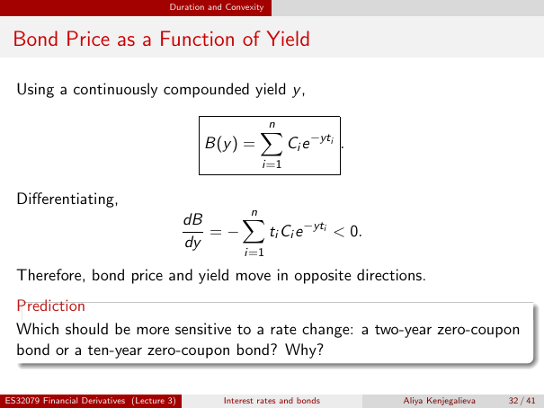

# Bond Price as a Function of Yield

Source: lecture-3; physical PDF page 32 of 41. Printed page/slide label: 32 / 41.

**Authored normalized transcription — needs independent review.** Typography, line wrapping and mathematical encoding are normalized; this is not unchanged raw extraction. Labelled corrections/qualifications are not original source text.

[Unchanged raw layout extraction](../../extracted/lecture-3/page-032.md#page-32)

## Price yield function

Using a continuously compounded yield $y$,
$$B(y)=\sum_{i=1}^{n}C_i e^{-yt_i}.$$

**Evidence locator:** lecture-3, physical PDF page 32 of 41; printed slide 32 / 41; region: Upper boxed equation. This is normalized source transcription, pending independent review.

[Unchanged raw layout extraction](../../extracted/lecture-3/page-032.md#page-32)

## Price first derivative

Differentiating,
$$\frac{dB}{dy}=-\sum_{i=1}^{n}t_iC_i e^{-yt_i}<0.$$
Therefore, bond price and yield move in opposite directions.

**Evidence locator:** lecture-3, physical PDF page 32 of 41; printed slide 32 / 41; region: Middle differentiation. This is normalized source transcription, pending independent review.

[Unchanged raw layout extraction](../../extracted/lecture-3/page-032.md#page-32)

## Sensitivity prediction

Which should be more sensitive to a rate change: a two-year zero-coupon bond or a ten-year zero-coupon bond? Why?

**Evidence locator:** lecture-3, physical PDF page 32 of 41; printed slide 32 / 41; region: Lower prediction box. This is normalized source transcription, pending independent review.

[Unchanged raw layout extraction](../../extracted/lecture-3/page-032.md#page-32)

## Page furniture (administrative)

Top section strip: Duration and Convexity.

Footer: ES32079 Financial Derivatives (Lecture 3); Interest rates and bonds; Aliya Kenjegalieva; 32 / 41.
