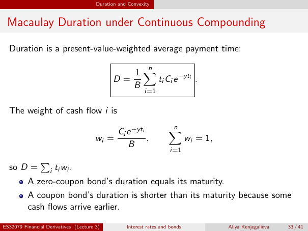

# Macaulay Duration under Continuous Compounding

Source: lecture-3; physical PDF page 33 of 41. Printed page/slide label: 33 / 41.

**Authored normalized transcription — needs independent review.** Typography, line wrapping and mathematical encoding are normalized; this is not unchanged raw extraction. Labelled corrections/qualifications are not original source text.

[Unchanged raw layout extraction](../../extracted/lecture-3/page-033.md#page-33)

## Duration definition

Duration is a present-value-weighted average payment time:
$$D=\frac1B\sum_{i=1}^{n}t_iC_i e^{-yt_i}.$$

**Evidence locator:** lecture-3, physical PDF page 33 of 41; printed slide 33 / 41; region: Upper definition and formula. This is normalized source transcription, pending independent review.

[Unchanged raw layout extraction](../../extracted/lecture-3/page-033.md#page-33)

## Duration weights

The weight of cash flow $i$ is
$$w_i=\frac{C_i e^{-yt_i}}{B},\qquad\sum_{i=1}^{n}w_i=1,$$
so $D=\sum_i t_iw_i$.

**Evidence locator:** lecture-3, physical PDF page 33 of 41; printed slide 33 / 41; region: Middle equations. This is normalized source transcription, pending independent review.

[Unchanged raw layout extraction](../../extracted/lecture-3/page-033.md#page-33)

## Duration maturity

A zero-coupon bond's duration equals its maturity. A coupon bond's duration is shorter than its maturity because some cash flows arrive earlier.

**Evidence locator:** lecture-3, physical PDF page 33 of 41; printed slide 33 / 41; region: Lower bullets. This is normalized source transcription, pending independent review.

[Unchanged raw layout extraction](../../extracted/lecture-3/page-033.md#page-33)

## Page furniture (administrative)

Top section strip: Duration and Convexity.

Footer: ES32079 Financial Derivatives (Lecture 3); Interest rates and bonds; Aliya Kenjegalieva; 33 / 41.
