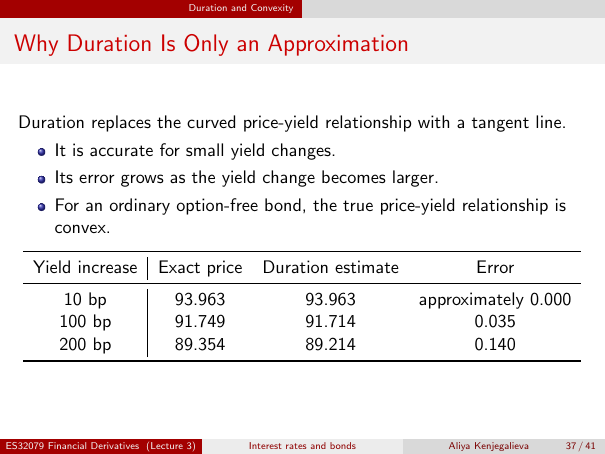

# Why Duration Is Only an Approximation

Source: lecture-3; physical PDF page 37 of 41. Printed page/slide label: 37 / 41.

**Authored normalized transcription — needs independent review.** Typography, line wrapping and mathematical encoding are normalized; this is not unchanged raw extraction. Labelled corrections/qualifications are not original source text.

[Unchanged raw layout extraction](../../extracted/lecture-3/page-037.md#page-37)

## Tangent approximation

Duration replaces the curved price-yield relationship with a tangent line.
- It is accurate for small yield changes.
- Its error grows as the yield change becomes larger.
- For an ordinary option-free bond, the true price-yield relationship is convex.

**Evidence locator:** lecture-3, physical PDF page 37 of 41; printed slide 37 / 41; region: Upper paragraph and bullets. This is normalized source transcription, pending independent review.

[Unchanged raw layout extraction](../../extracted/lecture-3/page-037.md#page-37)

## Duration errors table

Source comparison (rounded printed values):

| Yield increase | Exact price | Duration estimate | Error |
|---|---:|---:|---:|
| 10 bp | 93.963 | 93.963 | approximately 0.000 |
| 100 bp | 91.749 | 91.714 | 0.035 |
| 200 bp | 89.354 | 89.214 | 0.140 |

**Evidence locator:** lecture-3, physical PDF page 37 of 41; printed slide 37 / 41; region: Lower comparison table. This is normalized source transcription, pending independent review.

[Unchanged raw layout extraction](../../extracted/lecture-3/page-037.md#page-37)

## Page furniture (administrative)

Top section strip: Duration and Convexity.

Footer: ES32079 Financial Derivatives (Lecture 3); Interest rates and bonds; Aliya Kenjegalieva; 37 / 41.
