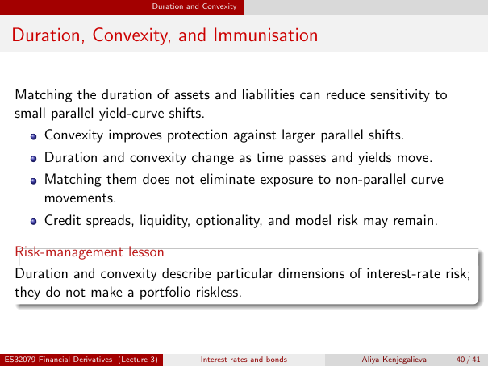

# Duration, Convexity, and Immunisation

Source: lecture-3; physical PDF page 40 of 41. Printed page/slide label: 40 / 41.

**Authored normalized transcription — needs independent review.** Typography, line wrapping and mathematical encoding are normalized; this is not unchanged raw extraction. Labelled corrections/qualifications are not original source text.

[Unchanged raw layout extraction](../../extracted/lecture-3/page-040.md#page-40)

## Immunisation benefit

Matching the duration of assets and liabilities can reduce sensitivity to small parallel yield-curve shifts. Convexity improves protection against larger parallel shifts.

**Evidence locator:** lecture-3, physical PDF page 40 of 41; printed slide 40 / 41; region: Opening paragraph and first bullet. This is normalized source transcription, pending independent review.

[Unchanged raw layout extraction](../../extracted/lecture-3/page-040.md#page-40)

## Immunisation limitations

Duration and convexity change as time passes and yields move. Matching them does not eliminate exposure to non-parallel curve movements. Credit spreads, liquidity, optionality, and model risk may remain.

**Evidence locator:** lecture-3, physical PDF page 40 of 41; printed slide 40 / 41; region: Remaining bullets. This is normalized source transcription, pending independent review.

[Unchanged raw layout extraction](../../extracted/lecture-3/page-040.md#page-40)

## Risk management caution

Duration and convexity describe particular dimensions of interest-rate risk; they do not make a portfolio riskless.

**Evidence locator:** lecture-3, physical PDF page 40 of 41; printed slide 40 / 41; region: Lower risk-management-lesson box. This is normalized source transcription, pending independent review.

[Unchanged raw layout extraction](../../extracted/lecture-3/page-040.md#page-40)

## Page furniture (administrative)

Top section strip: Duration and Convexity.

Footer: ES32079 Financial Derivatives (Lecture 3); Interest rates and bonds; Aliya Kenjegalieva; 40 / 41.
