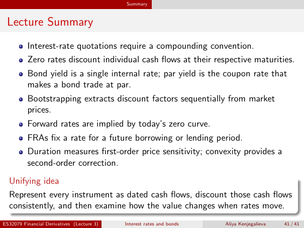

# Lecture Summary

Source: lecture-3; physical PDF page 41 of 41. Printed page/slide label: 41 / 41.

**Authored normalized transcription — needs independent review.** Typography, line wrapping and mathematical encoding are normalized; this is not unchanged raw extraction. Labelled corrections/qualifications are not original source text.

[Unchanged raw layout extraction](../../extracted/lecture-3/page-041.md#page-41)

## Summary compounding

Interest-rate quotations require a compounding convention.

**Evidence locator:** lecture-3, physical PDF page 41 of 41; printed slide 41 / 41; region: First bullet. This is normalized source transcription, pending independent review.

[Unchanged raw layout extraction](../../extracted/lecture-3/page-041.md#page-41)

## Summary zero

Zero rates discount individual cash flows at their respective maturities.

**Evidence locator:** lecture-3, physical PDF page 41 of 41; printed slide 41 / 41; region: Second bullet. This is normalized source transcription, pending independent review.

[Unchanged raw layout extraction](../../extracted/lecture-3/page-041.md#page-41)

## Summary yields

Bond yield is a single internal rate; par yield is the coupon rate that makes a bond trade at par.

**Evidence locator:** lecture-3, physical PDF page 41 of 41; printed slide 41 / 41; region: Third bullet. This is normalized source transcription, pending independent review.

[Unchanged raw layout extraction](../../extracted/lecture-3/page-041.md#page-41)

## Summary bootstrap

Bootstrapping extracts discount factors sequentially from market prices.

**Evidence locator:** lecture-3, physical PDF page 41 of 41; printed slide 41 / 41; region: Fourth bullet. This is normalized source transcription, pending independent review.

[Unchanged raw layout extraction](../../extracted/lecture-3/page-041.md#page-41)

## Summary forward

Forward rates are implied by today's zero curve.

**Evidence locator:** lecture-3, physical PDF page 41 of 41; printed slide 41 / 41; region: Fifth bullet. This is normalized source transcription, pending independent review.

[Unchanged raw layout extraction](../../extracted/lecture-3/page-041.md#page-41)

## Summary fra

FRAs fix a rate for a future borrowing or lending period.

**Evidence locator:** lecture-3, physical PDF page 41 of 41; printed slide 41 / 41; region: Sixth bullet. This is normalized source transcription, pending independent review.

[Unchanged raw layout extraction](../../extracted/lecture-3/page-041.md#page-41)

## Summary sensitivity

Duration measures first-order price sensitivity; convexity provides a second-order correction.

**Evidence locator:** lecture-3, physical PDF page 41 of 41; printed slide 41 / 41; region: Seventh bullet. This is normalized source transcription, pending independent review.

[Unchanged raw layout extraction](../../extracted/lecture-3/page-041.md#page-41)

## Summary unifying

Represent every instrument as dated cash flows, discount those cash flows consistently, and then examine how the value changes when rates move.

**Evidence locator:** lecture-3, physical PDF page 41 of 41; printed slide 41 / 41; region: Lower unifying-idea box. This is normalized source transcription, pending independent review.

[Unchanged raw layout extraction](../../extracted/lecture-3/page-041.md#page-41)

## Page furniture (administrative)

Top section strip: Summary.

Footer: ES32079 Financial Derivatives (Lecture 3); Interest rates and bonds; Aliya Kenjegalieva; 41 / 41.
