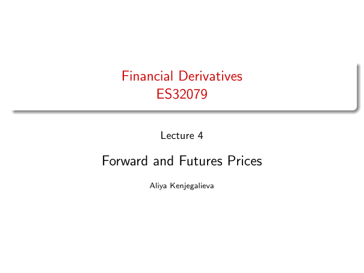

# Forward and Futures Prices

Source: lecture-4; physical PDF page 1 of 32. No printed page/slide number on title page.

**Authored normalized transcription — needs independent review.** Typography, line wrapping and mathematical encoding are normalized; this is not unchanged raw extraction. Labelled corrections/qualifications are not original source text.

[Unchanged raw layout extraction](../../extracted/lecture-4/page-001.md#page-1)

## Title

Financial Derivatives, ES32079. Lecture 4: Forward and Futures Prices. Aliya Kenjegalieva.

