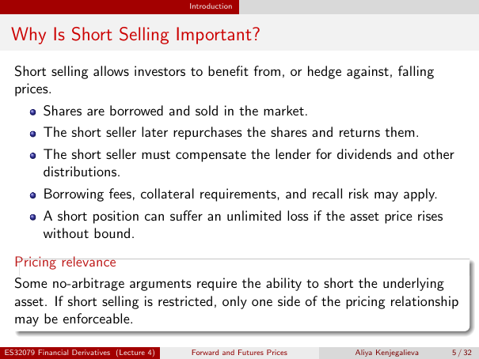

# Why Is Short Selling Important?

Source: lecture-4; physical PDF page 5 of 32. Printed page/slide label: 5 / 32.

**Authored normalized transcription — needs independent review.** Typography, line wrapping and mathematical encoding are normalized; this is not unchanged raw extraction. Labelled corrections/qualifications are not original source text.

[Unchanged raw layout extraction](../../extracted/lecture-4/page-005.md#page-5)

## Short sale mechanics

Short selling allows investors to benefit from, or hedge against, falling prices.
- Shares are borrowed and sold in the market.
- The short seller later repurchases the shares and returns them.
- The short seller must compensate the lender for dividends and other distributions.

**Evidence locator:** lecture-4, physical PDF page 5 of 32; printed slide 5 / 32; region: Upper paragraph and first three bullets. This is normalized source transcription, pending independent review.

[Unchanged raw layout extraction](../../extracted/lecture-4/page-005.md#page-5)

## Short sale risks

Borrowing fees, collateral requirements, and recall risk may apply. A short position can suffer an unlimited loss if the asset price rises without bound.

**Evidence locator:** lecture-4, physical PDF page 5 of 32; printed slide 5 / 32; region: Next two bullets. This is normalized source transcription, pending independent review.

[Unchanged raw layout extraction](../../extracted/lecture-4/page-005.md#page-5)

## Short sale pricing

Some no-arbitrage arguments require the ability to short the underlying asset. If short selling is restricted, only one side of the pricing relationship may be enforceable.

**Evidence locator:** lecture-4, physical PDF page 5 of 32; printed slide 5 / 32; region: Lower pricing-relevance box. This is normalized source transcription, pending independent review.

[Unchanged raw layout extraction](../../extracted/lecture-4/page-005.md#page-5)

## Page furniture (administrative)

Top section strip: Introduction.

Footer: ES32079 Financial Derivatives (Lecture 4); Forward and Futures Prices; Aliya Kenjegalieva; 5 / 32.
