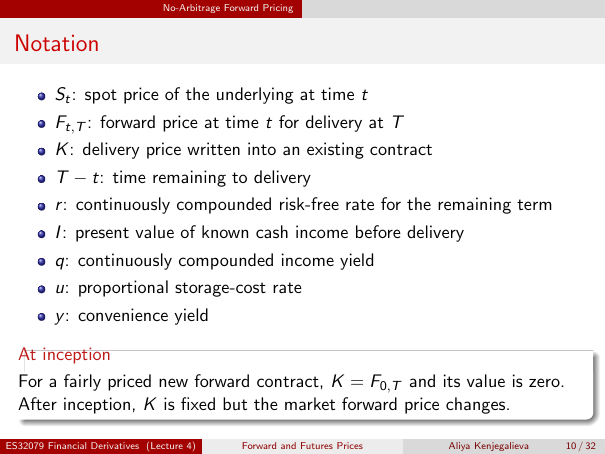

# Notation

Source: lecture-4; physical PDF page 10 of 32. Printed page/slide label: 10 / 32.

**Authored normalized transcription — needs independent review.** Typography, line wrapping and mathematical encoding are normalized; this is not unchanged raw extraction. Labelled corrections/qualifications are not original source text.

[Unchanged raw layout extraction](../../extracted/lecture-4/page-010.md#page-10)

## Spot forward delivery notation

$S_t$: spot price of the underlying at time $t$.

$F_{t,T}$: forward price at time $t$ for delivery at $T$.

$K$: delivery price written into an existing contract.

$T-t$: time remaining to delivery.

**Evidence locator:** lecture-4, physical PDF page 10 of 32; printed slide 10 / 32; region: Upper first four notation rows. This is normalized source transcription, pending independent review.

[Unchanged raw layout extraction](../../extracted/lecture-4/page-010.md#page-10)

## Carry notation

$r$: continuously compounded risk-free rate for the remaining term.

$I$: present value of known cash income before delivery.

$q$: continuously compounded income yield.

$u$: proportional storage-cost rate.

$y$: convenience yield.

**Evidence locator:** lecture-4, physical PDF page 10 of 32; printed slide 10 / 32; region: Remaining notation rows. This is normalized source transcription, pending independent review.

[Unchanged raw layout extraction](../../extracted/lecture-4/page-010.md#page-10)

## Inception versus later

For a fairly priced new forward contract, $K=F_{0,T}$ and its value is zero. After inception, $K$ is fixed but the market forward price changes.

**Evidence locator:** lecture-4, physical PDF page 10 of 32; printed slide 10 / 32; region: Lower at-inception box. This is normalized source transcription, pending independent review.

[Unchanged raw layout extraction](../../extracted/lecture-4/page-010.md#page-10)

## Page furniture (administrative)

Top section strip: No-Arbitrage Forward Pricing.

Footer: ES32079 Financial Derivatives (Lecture 4); Forward and Futures Prices; Aliya Kenjegalieva; 10 / 32.
