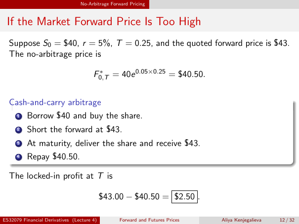

# If the Market Forward Price Is Too High

Source: lecture-4; physical PDF page 12 of 32. Printed page/slide label: 12 / 32.

**Authored normalized transcription — needs independent review.** Typography, line wrapping and mathematical encoding are normalized; this is not unchanged raw extraction. Labelled corrections/qualifications are not original source text.

[Unchanged raw layout extraction](../../extracted/lecture-4/page-012.md#page-12)

## Overpriced forward data

Suppose $S_0=\$40$, $r=5\%$, $T=0.25$, and the quoted forward price is $43. The no-arbitrage price is
$$F^*_{0,T}=40e^{0.05\times0.25}=\$40.50.$$

**Evidence locator:** lecture-4, physical PDF page 12 of 32; printed slide 12 / 32; region: Upper example and fair-price calculation. This is normalized source transcription, pending independent review.

[Unchanged raw layout extraction](../../extracted/lecture-4/page-012.md#page-12)

## Overpriced arbitrage

1. Borrow $40 and buy the share.
2. Short the forward at $43.
3. At maturity, deliver the share and receive $43.
4. Repay $40.50.

**Evidence locator:** lecture-4, physical PDF page 12 of 32; printed slide 12 / 32; region: Middle cash-and-carry strategy. This is normalized source transcription, pending independent review.

[Unchanged raw layout extraction](../../extracted/lecture-4/page-012.md#page-12)

## Overpriced profit

The locked-in profit at $T$ is $43.00-40.50=\$2.50$.

**Evidence locator:** lecture-4, physical PDF page 12 of 32; printed slide 12 / 32; region: Lower boxed profit. This is normalized source transcription, pending independent review.

[Unchanged raw layout extraction](../../extracted/lecture-4/page-012.md#page-12)

## Page furniture (administrative)

Top section strip: No-Arbitrage Forward Pricing.

Footer: ES32079 Financial Derivatives (Lecture 4); Forward and Futures Prices; Aliya Kenjegalieva; 12 / 32.
