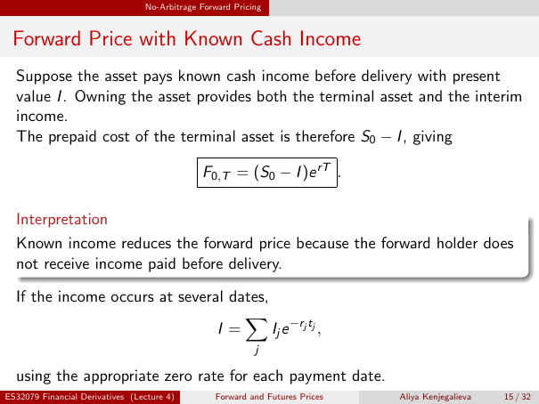

# Forward Price with Known Cash Income

Source: lecture-4; physical PDF page 15 of 32. Printed page/slide label: 15 / 32.

**Authored normalized transcription — needs independent review.** Typography, line wrapping and mathematical encoding are normalized; this is not unchanged raw extraction. Labelled corrections/qualifications are not original source text.

[Unchanged raw layout extraction](../../extracted/lecture-4/page-015.md#page-15)

## Known income replication

Suppose the asset pays known cash income before delivery with present value $I$. Owning the asset provides both the terminal asset and the interim income. The prepaid cost of the terminal asset is therefore $S_0-I$, giving
$$F_{0,T}=(S_0-I)e^{rT}.$$

**Evidence locator:** lecture-4, physical PDF page 15 of 32; printed slide 15 / 32; region: Upper paragraph and boxed equation. This is normalized source transcription, pending independent review.

[Unchanged raw layout extraction](../../extracted/lecture-4/page-015.md#page-15)

## Known income interpretation

Known income reduces the forward price because the forward holder does not receive income paid before delivery.

**Evidence locator:** lecture-4, physical PDF page 15 of 32; printed slide 15 / 32; region: Middle interpretation box. This is normalized source transcription, pending independent review.

[Unchanged raw layout extraction](../../extracted/lecture-4/page-015.md#page-15)

## Income present value sum

If the income occurs at several dates,
$$I=\sum_j I_j e^{-r_jt_j},$$
using the appropriate zero rate for each payment date.

**Evidence locator:** lecture-4, physical PDF page 15 of 32; printed slide 15 / 32; region: Lower equation and rate convention. This is normalized source transcription, pending independent review.

[Unchanged raw layout extraction](../../extracted/lecture-4/page-015.md#page-15)

## Page furniture (administrative)

Top section strip: No-Arbitrage Forward Pricing.

Footer: ES32079 Financial Derivatives (Lecture 4); Forward and Futures Prices; Aliya Kenjegalieva; 15 / 32.
