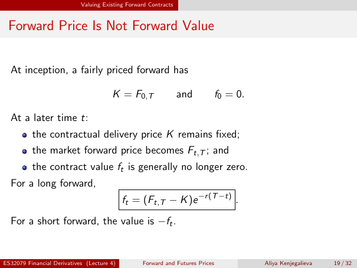

# Forward Price Is Not Forward Value

Source: lecture-4; physical PDF page 19 of 32. Printed page/slide label: 19 / 32.

**Authored normalized transcription — needs independent review.** Typography, line wrapping and mathematical encoding are normalized; this is not unchanged raw extraction. Labelled corrections/qualifications are not original source text.

[Unchanged raw layout extraction](../../extracted/lecture-4/page-019.md#page-19)

## Contract inception

At inception, a fairly priced forward has $K=F_{0,T}$ and $f_0=0$.

**Evidence locator:** lecture-4, physical PDF page 19 of 32; printed slide 19 / 32; region: Upper inception equation. This is normalized source transcription, pending independent review.

[Unchanged raw layout extraction](../../extracted/lecture-4/page-019.md#page-19)

## Contract later

At a later time $t$, the contractual delivery price $K$ remains fixed; the market forward price becomes $F_{t,T}$; and the contract value $f_t$ is generally no longer zero.

**Evidence locator:** lecture-4, physical PDF page 19 of 32; printed slide 19 / 32; region: Middle bullets. This is normalized source transcription, pending independent review.

[Unchanged raw layout extraction](../../extracted/lecture-4/page-019.md#page-19)

## Contract value

For a long forward,
$$f_t=(F_{t,T}-K)e^{-r(T-t)}.$$
For a short forward, the value is $-f_t$.

**Evidence locator:** lecture-4, physical PDF page 19 of 32; printed slide 19 / 32; region: Lower boxed formula and opposite-side statement. This is normalized source transcription, pending independent review.

[Unchanged raw layout extraction](../../extracted/lecture-4/page-019.md#page-19)

## Page furniture (administrative)

Top section strip: Valuing Existing Forward Contracts.

Footer: ES32079 Financial Derivatives (Lecture 4); Forward and Futures Prices; Aliya Kenjegalieva; 19 / 32.
