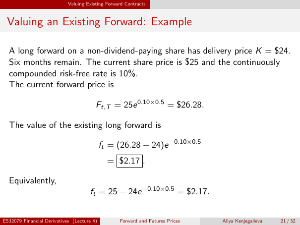

# Valuing an Existing Forward: Example

Source: lecture-4; physical PDF page 21 of 32. Printed page/slide label: 21 / 32.

**Authored normalized transcription — needs independent review.** Typography, line wrapping and mathematical encoding are normalized; this is not unchanged raw extraction. Labelled corrections/qualifications are not original source text.

[Unchanged raw layout extraction](../../extracted/lecture-4/page-021.md#page-21)

## Existing forward price example

A long forward on a non-dividend-paying share has delivery price $K=\$24$. Six months remain. The current share price is $25 and the continuously compounded risk-free rate is 10%. The current forward price is
$$F_{t,T}=25e^{0.10\times0.5}=\$26.28.$$

**Evidence locator:** lecture-4, physical PDF page 21 of 32; printed slide 21 / 32; region: Upper data and forward-price calculation. This is normalized source transcription, pending independent review.

[Unchanged raw layout extraction](../../extracted/lecture-4/page-021.md#page-21)

## Existing forward value example

The value of the existing long forward is
$$f_t=(26.28-24)e^{-0.10\times0.5}=\$2.17.$$
Equivalently,
$$f_t=25-24e^{-0.10\times0.5}=\$2.17.$$

**Evidence locator:** lecture-4, physical PDF page 21 of 32; printed slide 21 / 32; region: Middle and lower value calculations. This is normalized source transcription, pending independent review.

[Unchanged raw layout extraction](../../extracted/lecture-4/page-021.md#page-21)

## Page furniture (administrative)

Top section strip: Valuing Existing Forward Contracts.

Footer: ES32079 Financial Derivatives (Lecture 4); Forward and Futures Prices; Aliya Kenjegalieva; 21 / 32.
