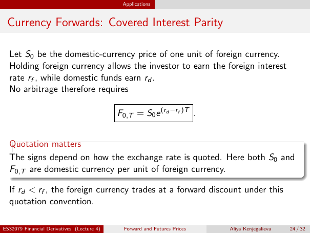

# Currency Forwards: Covered Interest Parity

Source: lecture-4; physical PDF page 24 of 32. Printed page/slide label: 24 / 32.

**Authored normalized transcription — needs independent review.** Typography, line wrapping and mathematical encoding are normalized; this is not unchanged raw extraction. Labelled corrections/qualifications are not original source text.

[Unchanged raw layout extraction](../../extracted/lecture-4/page-024.md#page-24)

## Currency quote investment

Let $S_0$ be the domestic-currency price of one unit of foreign currency. Holding foreign currency allows the investor to earn the foreign interest rate $r_f$, while domestic funds earn $r_d$.

**Evidence locator:** lecture-4, physical PDF page 24 of 32; printed slide 24 / 32; region: Opening paragraph. This is normalized source transcription, pending independent review.

[Unchanged raw layout extraction](../../extracted/lecture-4/page-024.md#page-24)

## Covered interest parity

No arbitrage therefore requires
$$F_{0,T}=S_0e^{(r_d-r_f)T}.$$

**Evidence locator:** lecture-4, physical PDF page 24 of 32; printed slide 24 / 32; region: Middle boxed formula. This is normalized source transcription, pending independent review.

[Unchanged raw layout extraction](../../extracted/lecture-4/page-024.md#page-24)

## Currency sign quotation

The signs depend on how the exchange rate is quoted. Here both $S_0$ and $F_{0,T}$ are domestic currency per unit of foreign currency. If $r_d<r_f$, the foreign currency trades at a forward discount under this quotation convention.

**Evidence locator:** lecture-4, physical PDF page 24 of 32; printed slide 24 / 32; region: Lower quotation-matters box and last sentence. This is normalized source transcription, pending independent review.

[Unchanged raw layout extraction](../../extracted/lecture-4/page-024.md#page-24)

## Page furniture (administrative)

Top section strip: Applications.

Footer: ES32079 Financial Derivatives (Lecture 4); Forward and Futures Prices; Aliya Kenjegalieva; 24 / 32.
