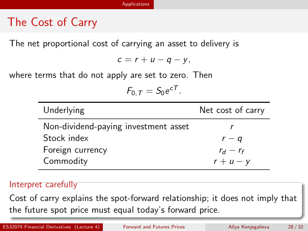

# The Cost of Carry

Source: lecture-4; physical PDF page 28 of 32. Printed page/slide label: 28 / 32.

**Authored normalized transcription — needs independent review.** Typography, line wrapping and mathematical encoding are normalized; this is not unchanged raw extraction. Labelled corrections/qualifications are not original source text.

[Unchanged raw layout extraction](../../extracted/lecture-4/page-028.md#page-28)

## Net carry definition

The net proportional cost of carrying an asset to delivery is
$$c=r+u-q-y,$$
where terms that do not apply are set to zero. Then
$$F_{0,T}=S_0e^{cT}.$$

**Evidence locator:** lecture-4, physical PDF page 28 of 32; printed slide 28 / 32; region: Upper definition and formulas. This is normalized source transcription, pending independent review.

[Unchanged raw layout extraction](../../extracted/lecture-4/page-028.md#page-28)

## Carry table

Source table:

| Underlying | Net cost of carry |
|---|---|
| Non-dividend-paying investment asset | $r$ |
| Stock index | $r-q$ |
| Foreign currency | $r_d-r_f$ |
| Commodity | $r+u-y$ |

**Evidence locator:** lecture-4, physical PDF page 28 of 32; printed slide 28 / 32; region: Middle table. This is normalized source transcription, pending independent review.

[Unchanged raw layout extraction](../../extracted/lecture-4/page-028.md#page-28)

## Carry not future spot

Cost of carry explains the spot-forward relationship; it does not imply that the future spot price must equal today's forward price.

**Evidence locator:** lecture-4, physical PDF page 28 of 32; printed slide 28 / 32; region: Lower interpret-carefully box. This is normalized source transcription, pending independent review.

[Unchanged raw layout extraction](../../extracted/lecture-4/page-028.md#page-28)

## Page furniture (administrative)

Top section strip: Applications.

Footer: ES32079 Financial Derivatives (Lecture 4); Forward and Futures Prices; Aliya Kenjegalieva; 28 / 32.
