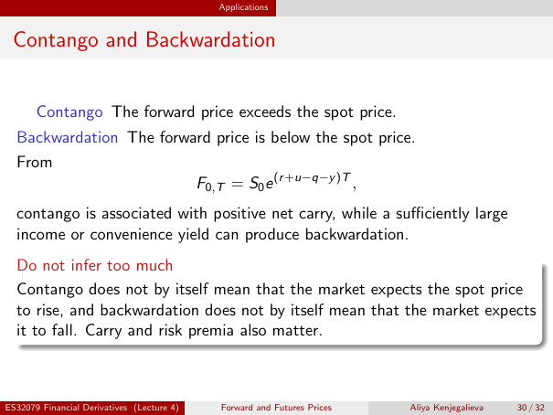

# Contango and Backwardation

Source: lecture-4; physical PDF page 30 of 32. Printed page/slide label: 30 / 32.

**Authored normalized transcription — needs independent review.** Typography, line wrapping and mathematical encoding are normalized; this is not unchanged raw extraction. Labelled corrections/qualifications are not original source text.

[Unchanged raw layout extraction](../../extracted/lecture-4/page-030.md#page-30)

## Contango definition

Contango: the forward price exceeds the spot price.

**Evidence locator:** lecture-4, physical PDF page 30 of 32; printed slide 30 / 32; region: Upper first definition. This is normalized source transcription, pending independent review.

[Unchanged raw layout extraction](../../extracted/lecture-4/page-030.md#page-30)

## Backwardation definition

Backwardation: the forward price is below the spot price.

**Evidence locator:** lecture-4, physical PDF page 30 of 32; printed slide 30 / 32; region: Upper second definition. This is normalized source transcription, pending independent review.

[Unchanged raw layout extraction](../../extracted/lecture-4/page-030.md#page-30)

## Net carry curve shape

From
$$F_{0,T}=S_0e^{(r+u-q-y)T},$$
contango is associated with positive net carry, while a sufficiently large income or convenience yield can produce backwardation.

**Evidence locator:** lecture-4, physical PDF page 30 of 32; printed slide 30 / 32; region: Middle formula and explanation. This is normalized source transcription, pending independent review.

[Unchanged raw layout extraction](../../extracted/lecture-4/page-030.md#page-30)

## Curve not expectation

Contango does not by itself mean that the market expects the spot price to rise, and backwardation does not by itself mean that the market expects it to fall. Carry and risk premia also matter.

**Evidence locator:** lecture-4, physical PDF page 30 of 32; printed slide 30 / 32; region: Lower do-not-infer-too-much box. This is normalized source transcription, pending independent review.

[Unchanged raw layout extraction](../../extracted/lecture-4/page-030.md#page-30)

## Page furniture (administrative)

Top section strip: Applications.

Footer: ES32079 Financial Derivatives (Lecture 4); Forward and Futures Prices; Aliya Kenjegalieva; 30 / 32.
