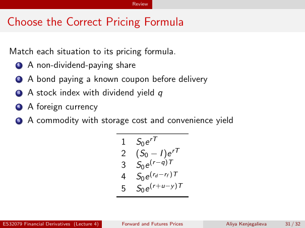

# Choose the Correct Pricing Formula

Source: lecture-4; physical PDF page 31 of 32. Printed page/slide label: 31 / 32.

**Authored normalized transcription — needs independent review.** Typography, line wrapping and mathematical encoding are normalized; this is not unchanged raw extraction. Labelled corrections/qualifications are not original source text.

[Unchanged raw layout extraction](../../extracted/lecture-4/page-031.md#page-31)

## Formula matching question

Match each situation to its pricing formula.
1. A non-dividend-paying share
2. A bond paying a known coupon before delivery
3. A stock index with dividend yield $q$
4. A foreign currency
5. A commodity with storage cost and convenience yield

**Evidence locator:** lecture-4, physical PDF page 31 of 32; printed slide 31 / 32; region: Upper instruction and five situations. This is normalized source transcription, pending independent review.

[Unchanged raw layout extraction](../../extracted/lecture-4/page-031.md#page-31)

## Formula matching answers

Source's corresponding numbered formulas:

| Number | Formula |
|---:|---|
| 1 | $S_0e^{rT}$ |
| 2 | $(S_0-I)e^{rT}$ |
| 3 | $S_0e^{(r-q)T}$ |
| 4 | $S_0e^{(r_d-r_f)T}$ |
| 5 | $S_0e^{(r+u-y)T}$ |

**Evidence locator:** lecture-4, physical PDF page 31 of 32; printed slide 31 / 32; region: Lower numbered formula table. This is normalized source transcription, pending independent review.

[Unchanged raw layout extraction](../../extracted/lecture-4/page-031.md#page-31)

## Page furniture (administrative)

Top section strip: Review.

Footer: ES32079 Financial Derivatives (Lecture 4); Forward and Futures Prices; Aliya Kenjegalieva; 31 / 32.
