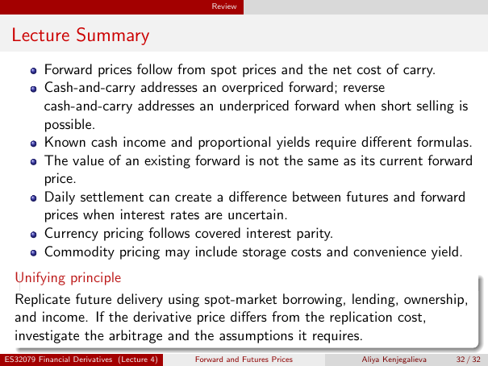

# Lecture Summary

Source: lecture-4; physical PDF page 32 of 32. Printed page/slide label: 32 / 32.

**Authored normalized transcription — needs independent review.** Typography, line wrapping and mathematical encoding are normalized; this is not unchanged raw extraction. Labelled corrections/qualifications are not original source text.

[Unchanged raw layout extraction](../../extracted/lecture-4/page-032.md#page-32)

## Summary carry

Forward prices follow from spot prices and the net cost of carry.

**Evidence locator:** lecture-4, physical PDF page 32 of 32; printed slide 32 / 32; region: First bullet. This is normalized source transcription, pending independent review.

[Unchanged raw layout extraction](../../extracted/lecture-4/page-032.md#page-32)

## Summary arbitrage

Cash-and-carry addresses an overpriced forward; reverse cash-and-carry addresses an underpriced forward when short selling is possible.

**Evidence locator:** lecture-4, physical PDF page 32 of 32; printed slide 32 / 32; region: Second bullet. This is normalized source transcription, pending independent review.

[Unchanged raw layout extraction](../../extracted/lecture-4/page-032.md#page-32)

## Summary income

Known cash income and proportional yields require different formulas.

**Evidence locator:** lecture-4, physical PDF page 32 of 32; printed slide 32 / 32; region: Third bullet. This is normalized source transcription, pending independent review.

[Unchanged raw layout extraction](../../extracted/lecture-4/page-032.md#page-32)

## Summary value

The value of an existing forward is not the same as its current forward price.

**Evidence locator:** lecture-4, physical PDF page 32 of 32; printed slide 32 / 32; region: Fourth bullet. This is normalized source transcription, pending independent review.

[Unchanged raw layout extraction](../../extracted/lecture-4/page-032.md#page-32)

## Summary settlement

Daily settlement can create a difference between futures and forward prices when interest rates are uncertain.

**Evidence locator:** lecture-4, physical PDF page 32 of 32; printed slide 32 / 32; region: Fifth bullet. This is normalized source transcription, pending independent review.

[Unchanged raw layout extraction](../../extracted/lecture-4/page-032.md#page-32)

## Summary currency

Currency pricing follows covered interest parity.

**Evidence locator:** lecture-4, physical PDF page 32 of 32; printed slide 32 / 32; region: Sixth bullet. This is normalized source transcription, pending independent review.

[Unchanged raw layout extraction](../../extracted/lecture-4/page-032.md#page-32)

## Summary commodity

Commodity pricing may include storage costs and convenience yield.

**Evidence locator:** lecture-4, physical PDF page 32 of 32; printed slide 32 / 32; region: Seventh bullet. This is normalized source transcription, pending independent review.

[Unchanged raw layout extraction](../../extracted/lecture-4/page-032.md#page-32)

## Summary replication

Replicate future delivery using spot-market borrowing, lending, ownership, and income. If the derivative price differs from the replication cost, investigate the arbitrage and the assumptions it requires.

**Evidence locator:** lecture-4, physical PDF page 32 of 32; printed slide 32 / 32; region: Lower unifying-principle box. This is normalized source transcription, pending independent review.

[Unchanged raw layout extraction](../../extracted/lecture-4/page-032.md#page-32)

## Page furniture (administrative)

Top section strip: Review.

Footer: ES32079 Financial Derivatives (Lecture 4); Forward and Futures Prices; Aliya Kenjegalieva; 32 / 32.
