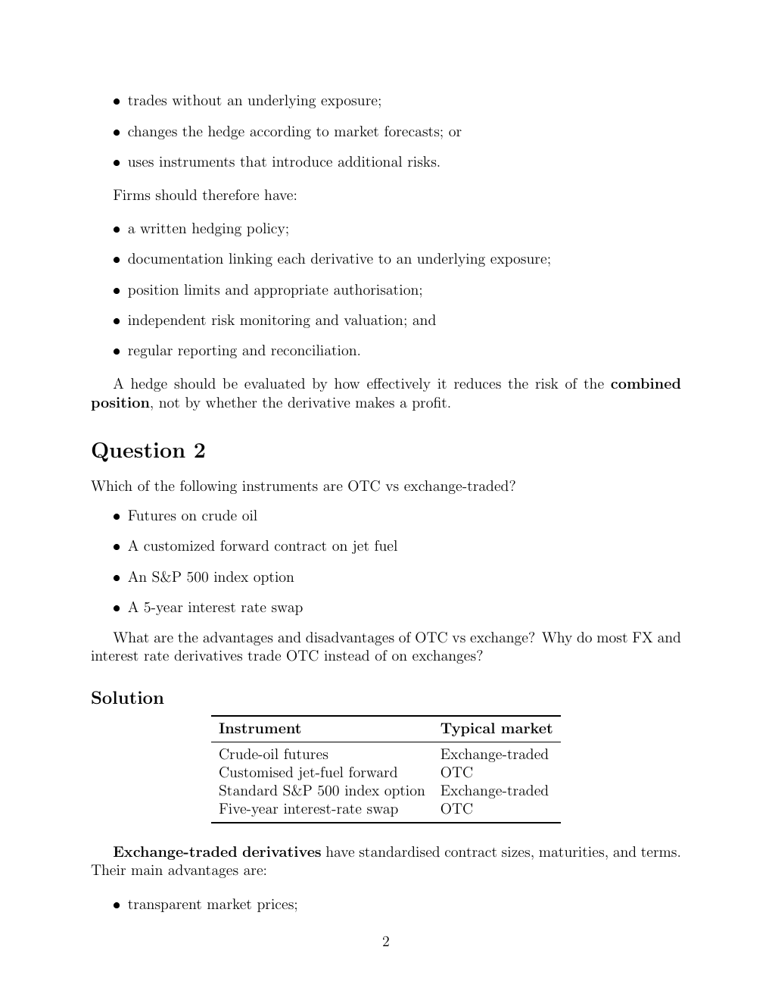

# seminar-1-solutions: physical page 2

Normalized source transcription, **needs independent review**. Supplied questions and supplied solutions remain distinct from authored teaching. Physical and printed page numbers coincide here.

## Source page label

ES32079 Financial Derivatives; Problem Set 1 Solutions; printed page 2.

## Supplied solution: speculative mismatch and controls (continued)

**Physical page 2; source region: Supplied solution: speculative mismatch and controls (continued).**

[Preserved raw extraction](../../extracted/seminar-1-solutions/page-002.md#page-2)

Continuation of Question 1. The remaining circumstances are:

- trades without an underlying exposure;
- changes the hedge according to market forecasts; or
- uses instruments that introduce additional risks.

Firms should therefore have:

- a written hedging policy;
- documentation linking each derivative to an underlying exposure;
- position limits and appropriate authorisation;
- independent risk monitoring and valuation; and
- regular reporting and reconciliation.

A hedge should be evaluated by how effectively it reduces the risk of the combined position, not by whether the derivative makes a profit.

## Question 2

**Physical page 2; source region: Question 2.**

[Preserved raw extraction](../../extracted/seminar-1-solutions/page-002.md#page-2)

Which of the following instruments are OTC vs exchange-traded?

- Futures on crude oil
- A customized forward contract on jet fuel
- An S&P 500 index option
- A 5-year interest rate swap

What are the advantages and disadvantages of OTC vs exchange? Why do most FX and interest rate derivatives trade OTC instead of on exchanges?

## Supplied solution: instrument and typical market table

**Physical page 2; source region: Supplied solution: instrument and typical market table.**

[Preserved raw extraction](../../extracted/seminar-1-solutions/page-002.md#page-2)

| Instrument | Typical market |
|---|---|
| Crude-oil futures | Exchange-traded |
| Customised jet-fuel forward | OTC |
| Standard S&P 500 index option | Exchange-traded |
| Five-year interest-rate swap | OTC |

## Supplied solution: exchange-traded terms and advantages (continues)

**Physical page 2; source region: Supplied solution: exchange-traded terms and advantages (continues).**

[Preserved raw extraction](../../extracted/seminar-1-solutions/page-002.md#page-2)

Exchange-traded derivatives have standardised contract sizes, maturities, and terms. Their main advantages include transparent market prices. The advantage list continues on physical page 3.
