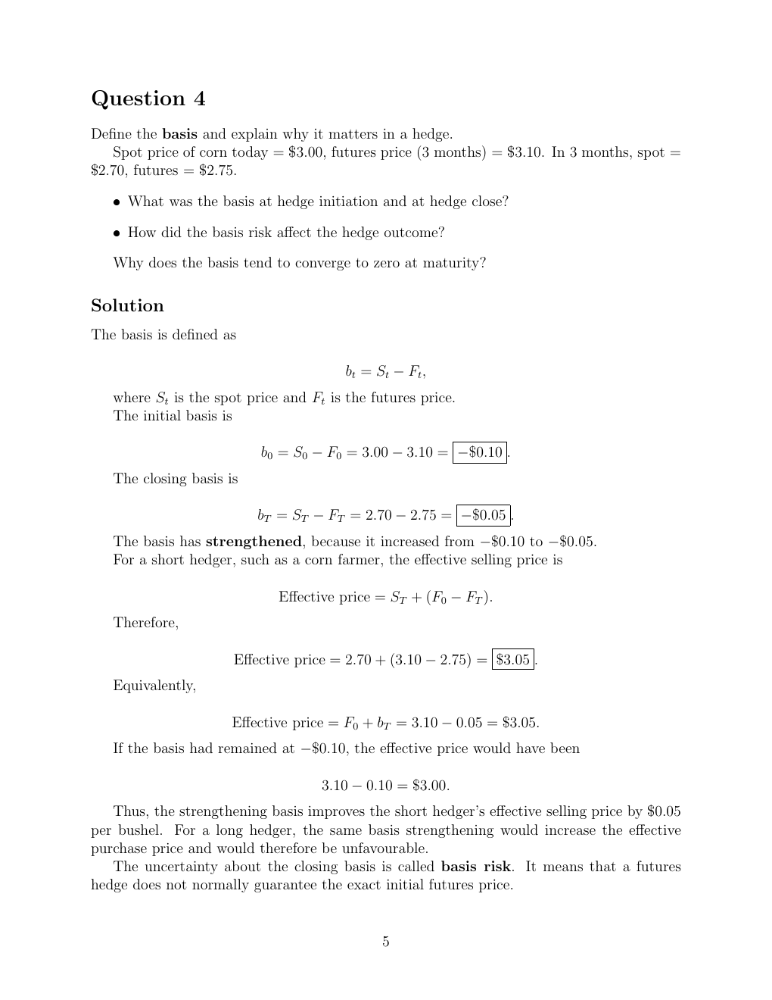

# seminar-1-solutions: physical page 5

Normalized source transcription, **needs independent review**. Supplied questions and supplied solutions remain distinct from authored teaching. Physical and printed page numbers coincide here.

## Source page label

ES32079 Financial Derivatives; Problem Set 1 Solutions; printed page 5.

## Question 4

**Physical page 5; source region: Question 4.**

[Preserved raw extraction](../../extracted/seminar-1-solutions/page-005.md#page-5)

Define the basis and explain why it matters in a hedge.

Spot price of corn today = $3.00, futures price (3 months) = $3.10. In 3 months, spot = $2.70, futures = $2.75.

- What was the basis at hedge initiation and at hedge close?
- How did the basis risk affect the hedge outcome?

Why does the basis tend to converge to zero at maturity?

## Supplied solution: basis definition and changes

**Physical page 5; source region: Supplied solution: basis definition and changes.**

[Preserved raw extraction](../../extracted/seminar-1-solutions/page-005.md#page-5)

The basis is defined as $b_t=S_t-F_t$, where $S_t$ is the spot price and $F_t$ is the futures price.

$$b_0=S_0-F_0=3.00-3.10=-0.10\text{ dollars},$$
$$b_T=S_T-F_T=2.70-2.75=-0.05\text{ dollars}.$$

The basis has strengthened because it increased from $-0.10$ to $-0.05$ dollars.

## Supplied solution: effect on short and long hedgers

**Physical page 5; source region: Supplied solution: effect on short and long hedgers.**

[Preserved raw extraction](../../extracted/seminar-1-solutions/page-005.md#page-5)

For a short hedger, such as a corn farmer,

$$\text{Effective selling price}=S_T+(F_0-F_T).$$

Therefore,

$$2.70+(3.10-2.75)=3.05\text{ dollars}.$$

Equivalently, $F_0+b_T=3.10-0.05=3.05$ dollars. If the basis had remained at $-0.10$, the effective price would have been $3.10-0.10=3.00$ dollars.

Thus the strengthening basis improves the short hedger’s effective selling price by $0.05 per bushel. For a long hedger, the same basis strengthening increases the effective purchase price and is unfavourable.

Uncertainty about the closing basis is called basis risk. A futures hedge does not normally guarantee the exact initial futures price.
