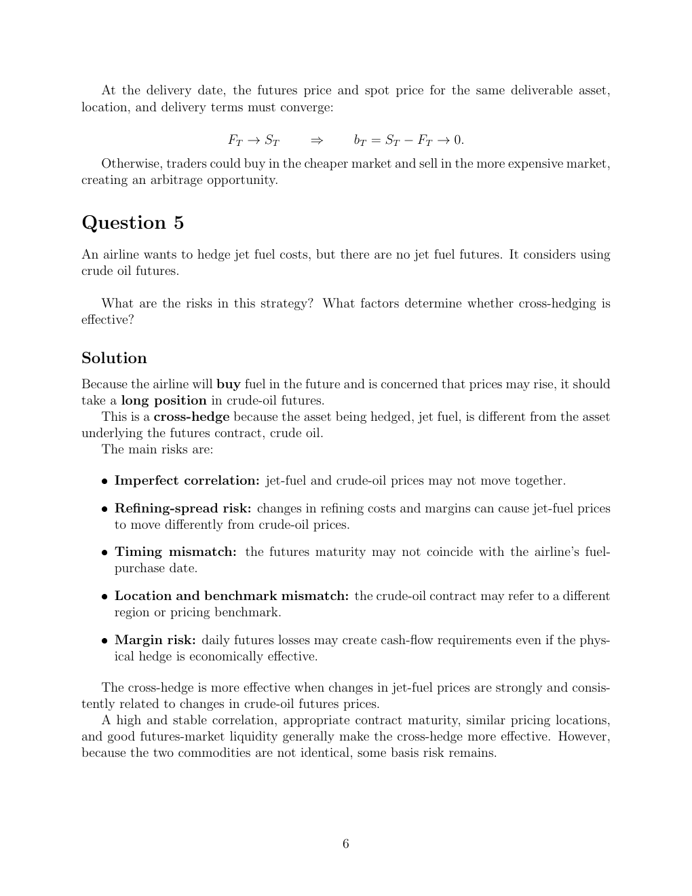

# seminar-1-solutions: physical page 6

Normalized source transcription, **needs independent review**. Supplied questions and supplied solutions remain distinct from authored teaching. Physical and printed page numbers coincide here.

## Source page label

ES32079 Financial Derivatives; Problem Set 1 Solutions; printed page 6.

## Supplied solution: convergence (continued)

**Physical page 6; source region: Supplied solution: convergence (continued).**

[Preserved raw extraction](../../extracted/seminar-1-solutions/page-006.md#page-6)

At the delivery date, the futures price and spot price for the same deliverable asset, location, and delivery terms must converge:

$$F_T\to S_T\quad\Rightarrow\quad b_T=S_T-F_T\to0.$$

Otherwise, traders could buy in the cheaper market and sell in the more expensive market, creating an arbitrage opportunity.

## Question 5

**Physical page 6; source region: Question 5.**

[Preserved raw extraction](../../extracted/seminar-1-solutions/page-006.md#page-6)

An airline wants to hedge jet fuel costs, but there are no jet fuel futures. It considers using crude oil futures.

What are the risks in this strategy? What factors determine whether cross-hedging is effective?

## Supplied solution: cross-hedge and residual risks

**Physical page 6; source region: Supplied solution: cross-hedge and residual risks.**

[Preserved raw extraction](../../extracted/seminar-1-solutions/page-006.md#page-6)

Because the airline will buy fuel in the future and is concerned that prices may rise, it should take a long position in crude-oil futures.

This is a cross-hedge because the asset being hedged, jet fuel, differs from the futures underlying, crude oil.

The main risks are:

- **Imperfect correlation:** jet-fuel and crude-oil prices may not move together.
- **Refining-spread risk:** changes in refining costs and margins can cause jet-fuel prices to move differently from crude-oil prices.
- **Timing mismatch:** futures maturity may not coincide with the airline’s fuel-purchase date.
- **Location and benchmark mismatch:** the crude-oil contract may refer to a different region or pricing benchmark.
- **Margin risk:** daily futures losses may create cash-flow requirements even if the physical hedge is economically effective.

The cross-hedge is more effective when changes in jet-fuel prices are strongly and consistently related to changes in crude-oil futures prices. High and stable correlation, appropriate contract maturity, similar pricing locations, and good futures-market liquidity generally improve effectiveness. Because the commodities are not identical, some basis risk remains.
