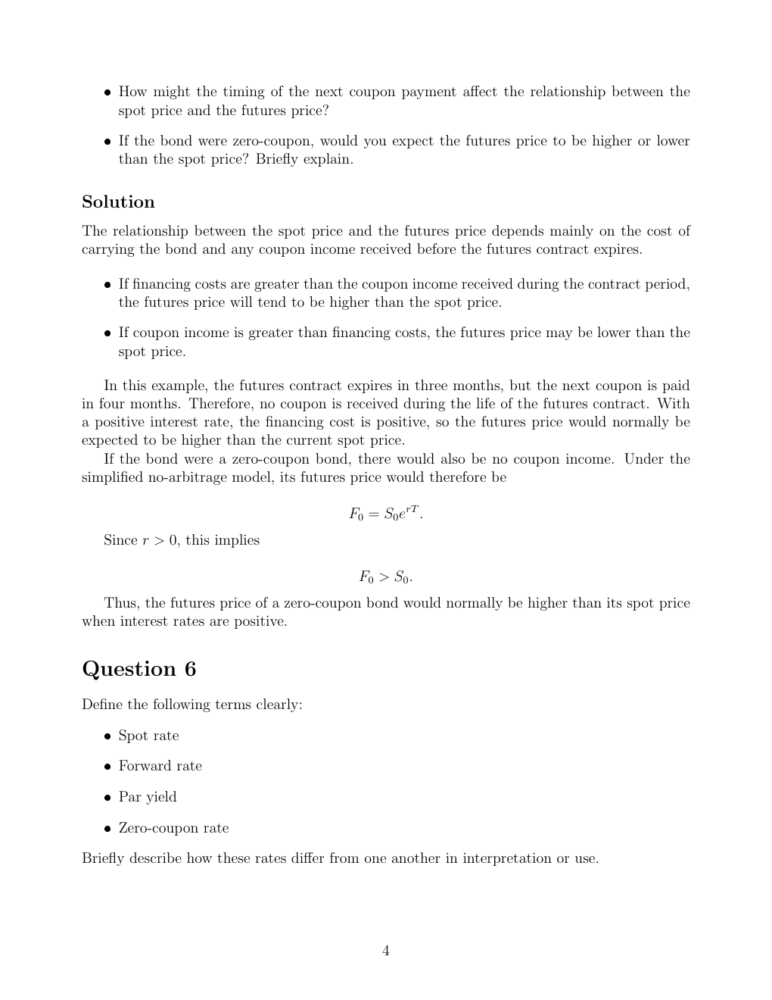

# seminar-2-solutions: physical page 4

Normalized source transcription, **needs independent review**. Supplied questions and supplied solutions remain distinct from authored teaching. Physical and printed page numbers coincide here.

## Source page label

ES32079 Financial Derivatives; Problem Set 2 Solutions; printed page 4.

## Question 5 (continued)

**Physical page 4; source region: Question 5 (continued).**

[Preserved raw extraction](../../extracted/seminar-2-solutions/page-004.md#page-4)

- How might the timing of the next coupon payment affect the relationship between spot and futures prices?
- If the bond were zero-coupon, would you expect futures to be higher or lower than spot? Briefly explain.

## Supplied solution: bond financing and coupon timing

**Physical page 4; source region: Supplied solution: bond financing and coupon timing.**

[Preserved raw extraction](../../extracted/seminar-2-solutions/page-004.md#page-4)

The spot/futures relationship depends mainly on carrying costs and coupon income received before futures expiry.

- If financing costs exceed coupon income during the contract period, futures tend to be higher than spot.
- If coupon income exceeds financing costs, futures may be lower than spot.

Here expiry is in three months but the next coupon is paid in four months. No coupon is received during the contract’s life. With a positive interest rate, financing cost is positive, so futures would normally be higher than current spot.

For a zero-coupon bond there is also no coupon income. Under the simplified no-arbitrage model,

$$F_0=S_0e^{rT}.$$

Since $r>0$, $F_0>S_0$. Thus zero-coupon bond futures would normally be higher than spot when rates are positive.

**Model scope:** this is the supplied simplified comparison, not a full Treasury-futures conversion-factor, accrued-interest, delivery-option or stochastic-rate valuation.

## Question 6

**Physical page 4; source region: Question 6.**

[Preserved raw extraction](../../extracted/seminar-2-solutions/page-004.md#page-4)

Define clearly: spot rate; forward rate; par yield; zero-coupon rate.

Briefly describe how these rates differ from one another in interpretation or use.
