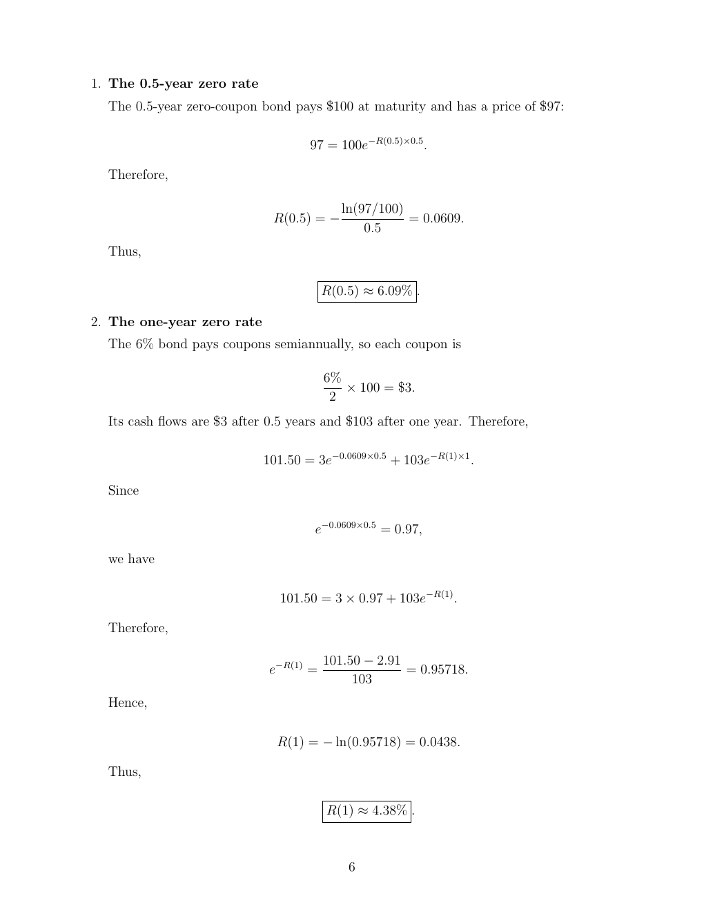

# seminar-2-solutions: physical page 6

Normalized source transcription, **needs independent review**. Supplied questions and supplied solutions remain distinct from authored teaching. Physical and printed page numbers coincide here.

## Source page label

ES32079 Financial Derivatives; Problem Set 2 Solutions; printed page 6.

## Supplied solution: 0.5-year zero rate

**Physical page 6; source region: Supplied solution: 0.5-year zero rate.**

[Preserved raw extraction](../../extracted/seminar-2-solutions/page-006.md#page-6)

Under the solution’s continuously compounded zero-rate convention, the zero-coupon bond pays $100 at maturity and costs $97:

$$97=100e^{-R(0.5)\times0.5}.$$

Therefore,

$$R(0.5)=-\frac{\ln(97/100)}{0.5}=0.0609\approx6.09\%.$$

The displayed decimal is rounded. The separate problem specifies annual coupons, while this supplied solution uses semiannual coupons for the coupon bonds.

## Supplied solution: one-year zero rate

**Physical page 6; source region: Supplied solution: one-year zero rate.**

[Preserved raw extraction](../../extracted/seminar-2-solutions/page-006.md#page-6)

Under the supplied solution’s **semiannual-coupon** assumption, the 6% bond pays $\frac{6\%}{2}\times100=3$ dollars each half-year. Cash flows are $3 after 0.5 years and $103 after one year:

$$101.50=3e^{-0.0609\times0.5}+103e^{-R(1)\times1}.$$

The source writes $e^{-0.0609\times0.5}=0.97$ (using a rounded exponent), hence

$$101.50=3\times0.97+103e^{-R(1)},$$
$$e^{-R(1)}=\frac{101.50-2.91}{103}=0.95718,$$
$$R(1)=-\ln(0.95718)=0.0438\approx4.38\%.$$

**Rounding qualification:** the printed equalities use rounded rates/discount factors; use the exact $0.97$ half-year discount factor for numerical checks. **Source conflict:** this answer is conditional on semiannual coupons, whereas the separate problem says annual coupons.
