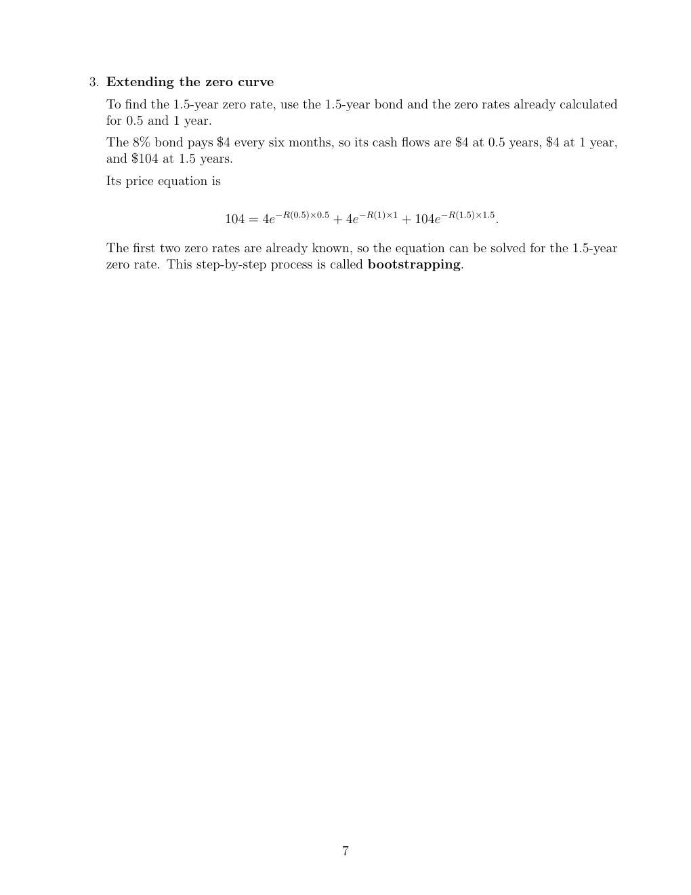

# seminar-2-solutions: physical page 7

Normalized source transcription, **needs independent review**. Supplied questions and supplied solutions remain distinct from authored teaching. Physical and printed page numbers coincide here.

## Source page label

ES32079 Financial Derivatives; Problem Set 2 Solutions; printed page 7.

## Supplied solution: extending the zero curve

**Physical page 7; source region: Supplied solution: extending the zero curve.**

[Preserved raw extraction](../../extracted/seminar-2-solutions/page-007.md#page-7)

To find the 1.5-year zero rate, use the 1.5-year bond and the already calculated 0.5- and 1-year rates. The 8% bond pays $4 every six months: $4 at 0.5 years, $4 at 1 year, and $104 at 1.5 years.

$$104=4e^{-R(0.5)\times0.5}+4e^{-R(1)\times1}+104e^{-R(1.5)\times1.5}.$$

The first two zero rates are known, so solve for the 1.5-year zero rate. This step-by-step process is called **bootstrapping**.

**Source conflict:** these cash flows use the supplied solution’s semiannual coupons and continuously compounded zero rates, not the separate problem’s annual-coupon assumption. No numerical 1.5-year result is printed in this supplied solution.
