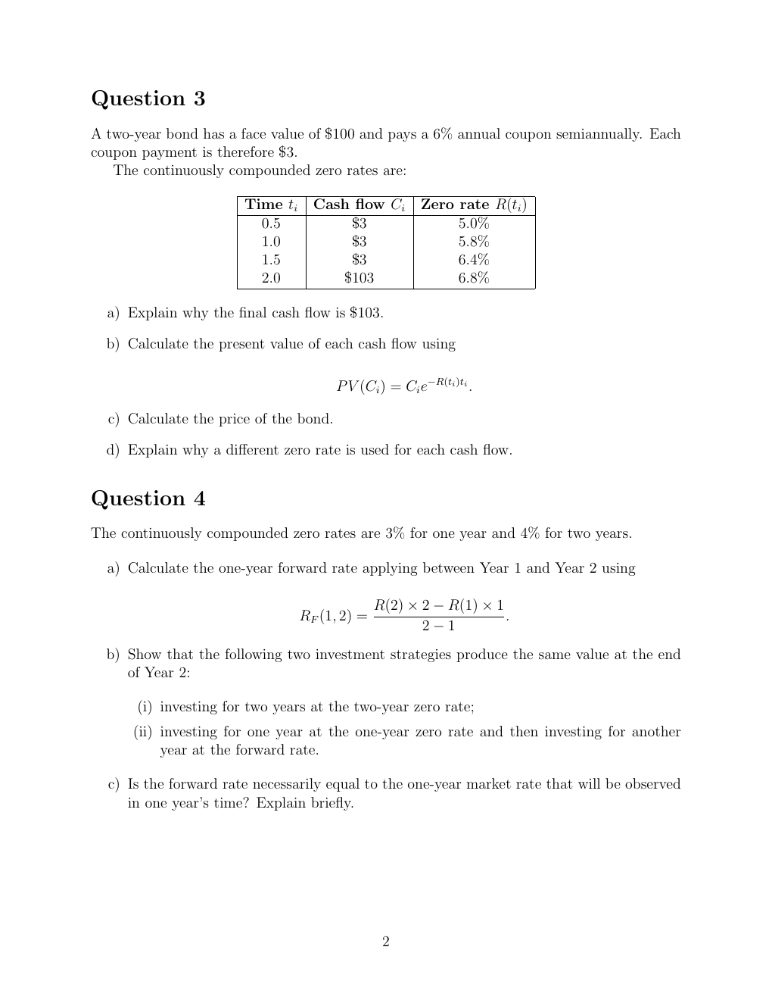

# seminar-3-problems: physical page 2

Normalized source transcription, **needs independent review**. Supplied questions and supplied solutions remain distinct from authored teaching. Physical and printed page numbers coincide here.

## Source page label

ES32079 Financial Derivatives; Problem Set 3; printed page 2.

## Question 3: cash-flow table and bond pricing

**Physical page 2; source region: Question 3: cash-flow table and bond pricing.**

[Preserved raw extraction](../../extracted/seminar-3-problems/page-002.md#page-2)

A two-year bond has face value $100 and a 6% annual coupon paid semiannually. Each coupon is $3. Continuously compounded zero rates are:

| Time $t_i$ | Cash flow $C_i$ | Zero rate $R(t_i)$ |
|---|---|---|
| 0.5 | $3 | 5.0% |
| 1.0 | $3 | 5.8% |
| 1.5 | $3 | 6.4% |
| 2.0 | $103 | 6.8% |

a) Explain why the final cash flow is $103.

b) Calculate each present value using $PV(C_i)=C_i e^{-R(t_i)t_i}$.

c) Calculate the bond price.

d) Explain why a different zero rate is used for each cash flow.

No official seminar-3 solution was supplied.

## Question 4: forward rate and equivalent strategies

**Physical page 2; source region: Question 4: forward rate and equivalent strategies.**

[Preserved raw extraction](../../extracted/seminar-3-problems/page-002.md#page-2)

Continuously compounded zero rates are 3% for one year and 4% for two years.

a) Calculate the one-year forward rate between Year 1 and Year 2 using

$$R_F(1,2)=\frac{R(2)\times2-R(1)\times1}{2-1}.$$

b) Show that two strategies produce the same value at the end of Year 2:

(i) investing for two years at the two-year zero rate;

(ii) investing for one year at the one-year zero rate and then another year at the forward rate.

c) Is the forward rate necessarily the one-year market rate observed in one year’s time? Explain briefly.

No official seminar-3 solution was supplied.
