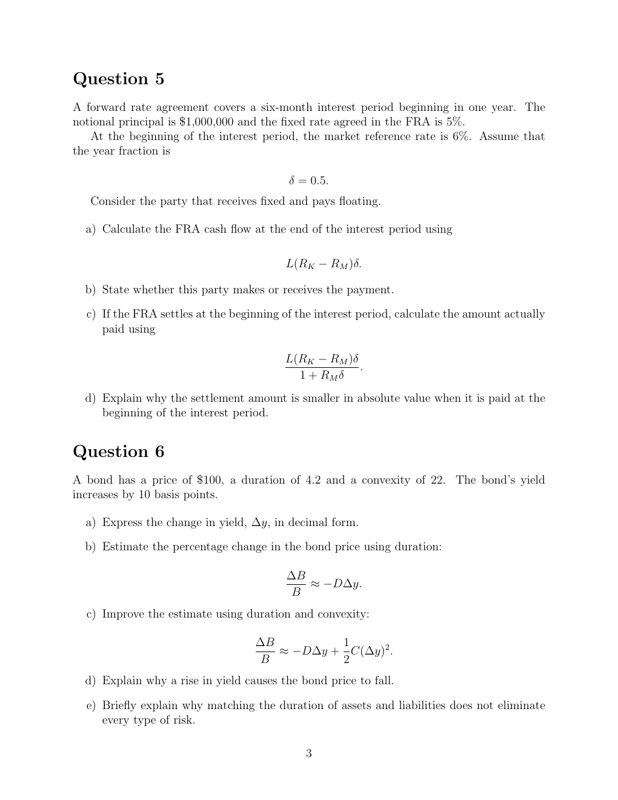

# seminar-3-problems: physical page 3

Normalized source transcription, **needs independent review**. Supplied questions and supplied solutions remain distinct from authored teaching. Physical and printed page numbers coincide here.

## Source page label

ES32079 Financial Derivatives; Problem Set 3; printed page 3.

## Question 5: FRA settlement

**Physical page 3; source region: Question 5: FRA settlement.**

[Preserved raw extraction](../../extracted/seminar-3-problems/page-003.md#page-3)

A forward rate agreement covers a six-month interest period beginning in one year. Notional principal is $1,000,000 and the agreed FRA fixed rate is 5%. At the beginning of the period the market reference rate is 6%. Assume year fraction $\delta=0.5$. Consider the party that **receives fixed and pays floating**.

a) Calculate the end-of-period FRA cash flow using $L(R_K-R_M)\delta$.

b) State whether this party makes or receives payment.

c) If settlement is at the beginning of the period, calculate the amount actually paid using

$$\frac{L(R_K-R_M)\delta}{1+R_M\delta}.$$

d) Explain why beginning-of-period settlement is smaller in absolute value.

No official seminar-3 solution was supplied.

## Question 6: duration and convexity

**Physical page 3; source region: Question 6: duration and convexity.**

[Preserved raw extraction](../../extracted/seminar-3-problems/page-003.md#page-3)

A bond has price $100, duration 4.2 and convexity 22. Its yield increases by 10 basis points.

a) Express the change in yield, $\Delta y$, in decimal form.

b) Estimate the percentage bond-price change using duration:

$$\frac{\Delta B}{B}\approx-D\Delta y.$$

c) Improve the estimate with duration and convexity:

$$\frac{\Delta B}{B}\approx-D\Delta y+\frac12 C(\Delta y)^2.$$

d) Explain why a yield increase causes price to fall.

e) Explain briefly why matching asset and liability duration does not eliminate every type of risk.

No official seminar-3 solution was supplied.
