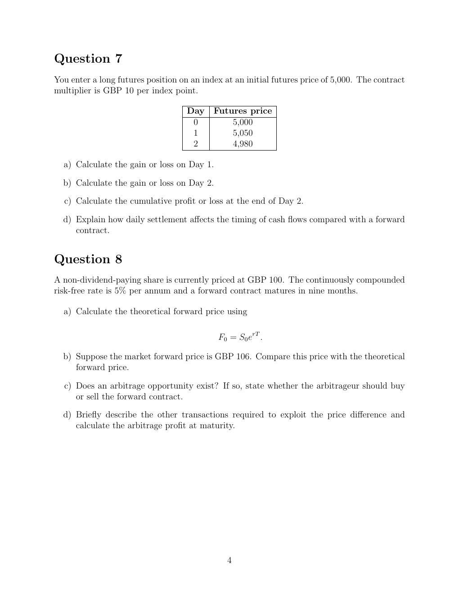

# seminar-3-problems: physical page 4

Normalized source transcription, **needs independent review**. Supplied questions and supplied solutions remain distinct from authored teaching. Physical and printed page numbers coincide here.

## Source page label

ES32079 Financial Derivatives; Problem Set 3; printed page 4.

## Question 7: daily futures settlement

**Physical page 4; source region: Question 7: daily futures settlement.**

[Preserved raw extraction](../../extracted/seminar-3-problems/page-004.md#page-4)

Enter a long index-futures position at initial futures price 5,000, with multiplier GBP 10 per index point.

| Day | Futures price |
|---|---|
| 0 | 5,000 |
| 1 | 5,050 |
| 2 | 4,980 |

a) Calculate Day 1 gain or loss.

b) Calculate Day 2 gain or loss.

c) Calculate cumulative profit or loss at the end of Day 2.

d) Explain how daily settlement changes cash-flow timing relative to a forward contract.

No official seminar-3 solution was supplied.

## Question 8: forward price and arbitrage

**Physical page 4; source region: Question 8: forward price and arbitrage.**

[Preserved raw extraction](../../extracted/seminar-3-problems/page-004.md#page-4)

A non-dividend-paying share is currently GBP 100. The continuously compounded risk-free rate is 5% per annum and a forward matures in nine months.

a) Calculate the theoretical forward price using $F_0=S_0e^{rT}$.

b) If the market forward price is GBP 106, compare it with the theoretical price.

c) Does an arbitrage opportunity exist? If so, should the arbitrageur buy or sell the forward?

d) Describe the other transactions required and calculate arbitrage profit at maturity.

No official seminar-3 solution was supplied.
