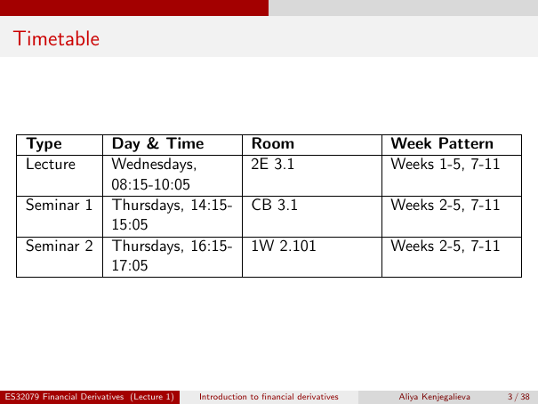

# Physical page 3 — raw extraction, needs review

<a id="page-3"></a>



Raw layout text below may flatten formulas, tables and glyphs. The image is source evidence; no semantic verification is claimed.

```text
 Timetable


     Type                Day & Time                      Room                       Week Pattern
     Lecture             Wednesdays,                     2E 3.1                     Weeks 1-5, 7-11
                         08:15-10:05
     Seminar 1           Thursdays, 14:15-               CB 3.1                     Weeks 2-5, 7-11
                         15:05
     Seminar 2           Thursdays, 16:15-               1W 2.101                   Weeks 2-5, 7-11
                         17:05


ES32079 Financial Derivatives (Lecture 1)   Introduction to financial derivatives    Aliya Kenjegalieva   3 / 38

```
