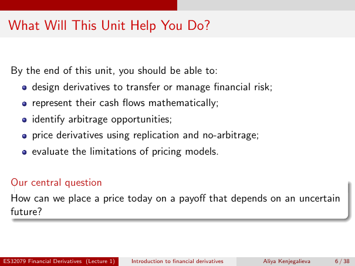

# Physical page 6 — raw extraction, needs review

<a id="page-6"></a>



Raw layout text below may flatten formulas, tables and glyphs. The image is source evidence; no semantic verification is claimed.

```text
 What Will This Unit Help You Do?


  By the end of this unit, you should be able to:
          design derivatives to transfer or manage financial risk;
          represent their cash flows mathematically;
          identify arbitrage opportunities;
          price derivatives using replication and no-arbitrage;
          evaluate the limitations of pricing models.

  Our central question
  How can we place a price today on a payoff that depends on an uncertain
  future?


ES32079 Financial Derivatives (Lecture 1)   Introduction to financial derivatives   Aliya Kenjegalieva   6 / 38

```
