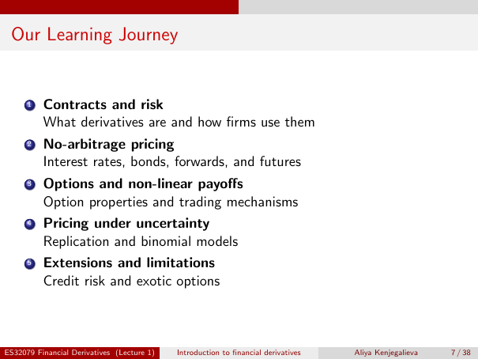

# Physical page 7 — raw extraction, needs review

<a id="page-7"></a>



Raw layout text below may flatten formulas, tables and glyphs. The image is source evidence; no semantic verification is claimed.

```text
 Our Learning Journey


      1   Contracts and risk
          What derivatives are and how firms use them
      2   No-arbitrage pricing
          Interest rates, bonds, forwards, and futures
      3   Options and non-linear payoffs
          Option properties and trading mechanisms
      4   Pricing under uncertainty
          Replication and binomial models
      5   Extensions and limitations
          Credit risk and exotic options


ES32079 Financial Derivatives (Lecture 1)   Introduction to financial derivatives   Aliya Kenjegalieva   7 / 38

```
