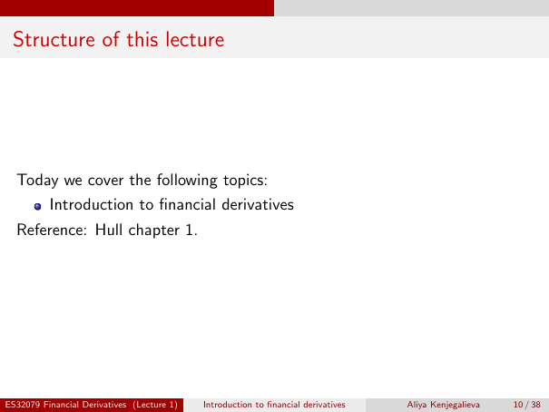

# Physical page 10 — raw extraction, needs review

<a id="page-10"></a>



Raw layout text below may flatten formulas, tables and glyphs. The image is source evidence; no semantic verification is claimed.

```text
 Structure of this lecture


  Today we cover the following topics:
          Introduction to financial derivatives
  Reference: Hull chapter 1.


ES32079 Financial Derivatives (Lecture 1)   Introduction to financial derivatives   Aliya Kenjegalieva   10 / 38

```
