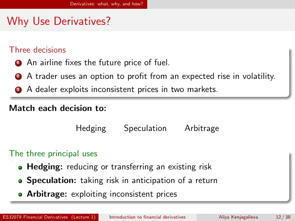

# Physical page 12 — raw extraction, needs review

<a id="page-12"></a>



Raw layout text below may flatten formulas, tables and glyphs. The image is source evidence; no semantic verification is claimed.

```text
                             Derivatives: what, why, and how?


 Why Use Derivatives?

  Three decisions
   1 An airline fixes the future price of fuel.

      2   A trader uses an option to profit from an expected rise in volatility.
      3   A dealer exploits inconsistent prices in two markets.

  Match each decision to:

                                Hedging              Speculation                  Arbitrage

  The three principal uses
      Hedging: reducing or transferring an existing risk
          Speculation: taking risk in anticipation of a return
          Arbitrage: exploiting inconsistent prices

ES32079 Financial Derivatives (Lecture 1)     Introduction to financial derivatives       Aliya Kenjegalieva   12 / 38

```
