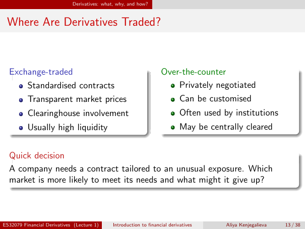

# Physical page 13 — raw extraction, needs review

<a id="page-13"></a>



Raw layout text below may flatten formulas, tables and glyphs. The image is source evidence; no semantic verification is claimed.

```text
                             Derivatives: what, why, and how?


 Where Are Derivatives Traded?


  Exchange-traded                                                   Over-the-counter
      Standardised contracts                                            Privately negotiated
          Transparent market prices                                          Can be customised
          Clearinghouse involvement                                          Often used by institutions
          Usually high liquidity                                             May be centrally cleared


  Quick decision
  A company needs a contract tailored to an unusual exposure. Which
  market is more likely to meet its needs and what might it give up?


ES32079 Financial Derivatives (Lecture 1)     Introduction to financial derivatives      Aliya Kenjegalieva   13 / 38

```
