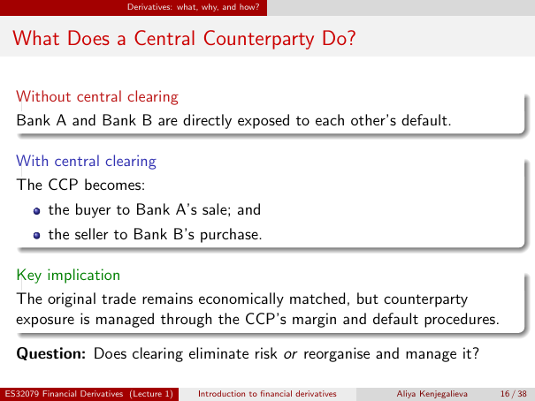

# Physical page 16 — raw extraction, needs review

<a id="page-16"></a>



Raw layout text below may flatten formulas, tables and glyphs. The image is source evidence; no semantic verification is claimed.

```text
                             Derivatives: what, why, and how?


 What Does a Central Counterparty Do?

  Without central clearing
  Bank A and Bank B are directly exposed to each other’s default.

  With central clearing
  The CCP becomes:
          the buyer to Bank A’s sale; and
          the seller to Bank B’s purchase.

  Key implication
  The original trade remains economically matched, but counterparty
  exposure is managed through the CCP’s margin and default procedures.

  Question: Does clearing eliminate risk or reorganise and manage it?

ES32079 Financial Derivatives (Lecture 1)     Introduction to financial derivatives   Aliya Kenjegalieva   16 / 38

```
