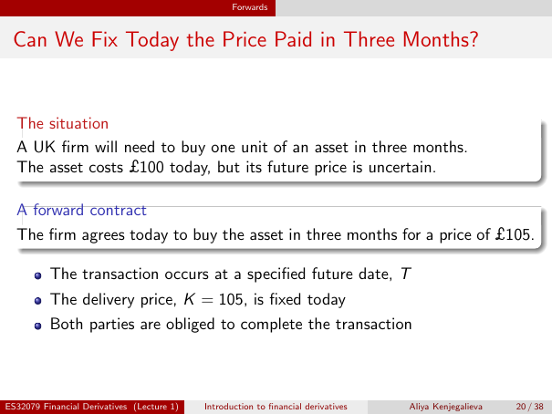

# Physical page 20 — raw extraction, needs review

<a id="page-20"></a>



Raw layout text below may flatten formulas, tables and glyphs. The image is source evidence; no semantic verification is claimed.

```text
                                                   Forwards


 Can We Fix Today the Price Paid in Three Months?


  The situation
  A UK firm will need to buy one unit of an asset in three months.
  The asset costs £100 today, but its future price is uncertain.

  A forward contract
  The firm agrees today to buy the asset in three months for a price of £105.

          The transaction occurs at a specified future date, T
          The delivery price, K = 105, is fixed today
          Both parties are obliged to complete the transaction


ES32079 Financial Derivatives (Lecture 1)   Introduction to financial derivatives   Aliya Kenjegalieva   20 / 38

```
