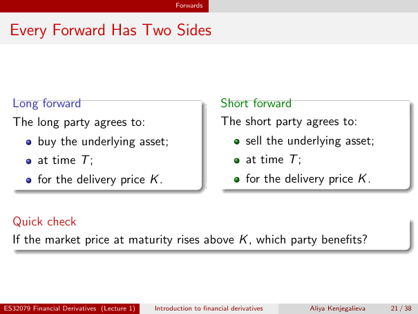

# Physical page 21 — raw extraction, needs review

<a id="page-21"></a>



Raw layout text below may flatten formulas, tables and glyphs. The image is source evidence; no semantic verification is claimed.

```text
                                                   Forwards


 Every Forward Has Two Sides


  Long forward                                                    Short forward
  The long party agrees to:                                       The short party agrees to:
          buy the underlying asset;                                        sell the underlying asset;
          at time T ;                                                      at time T ;
          for the delivery price K .                                       for the delivery price K .


  Quick check
  If the market price at maturity rises above K , which party benefits?


ES32079 Financial Derivatives (Lecture 1)   Introduction to financial derivatives        Aliya Kenjegalieva   21 / 38

```
