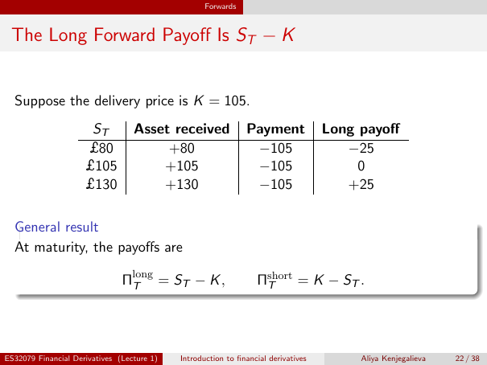

# Physical page 22 — raw extraction, needs review

<a id="page-22"></a>



Raw layout text below may flatten formulas, tables and glyphs. The image is source evidence; no semantic verification is claimed.

```text
                                                   Forwards


 The Long Forward Payoff Is ST − K


  Suppose the delivery price is K = 105.
                      ST          Asset received               Payment              Long payoff
                     £80               +80                      −105                   −25
                     £105             +105                      −105                     0
                     £130             +130                      −105                   +25

  General result
  At maturity, the payoffs are

                               Πlong
                                T    = ST − K ,                   Πshort
                                                                   T     = K − ST .


ES32079 Financial Derivatives (Lecture 1)   Introduction to financial derivatives        Aliya Kenjegalieva   22 / 38

```
