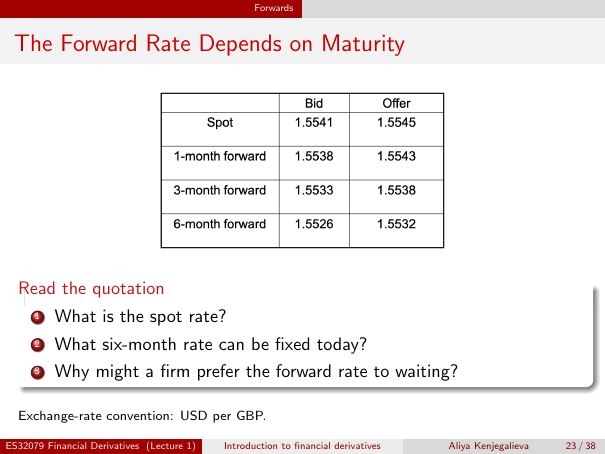

# Physical page 23 — raw extraction, needs review

<a id="page-23"></a>



Raw layout text below may flatten formulas, tables and glyphs. The image is source evidence; no semantic verification is claimed.

```text
                                                   Forwards


 The Forward Rate Depends on Maturity


  Read the quotation
      1   What is the spot rate?
      2   What six-month rate can be fixed today?
      3   Why might a firm prefer the forward rate to waiting?

  Exchange-rate convention: USD per GBP.

ES32079 Financial Derivatives (Lecture 1)   Introduction to financial derivatives   Aliya Kenjegalieva   23 / 38

```
