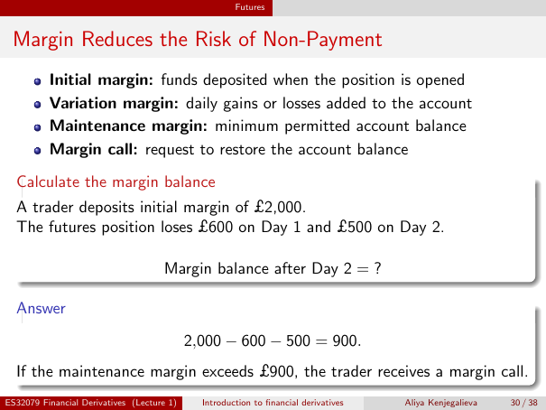

# Physical page 30 — raw extraction, needs review

<a id="page-30"></a>



Raw layout text below may flatten formulas, tables and glyphs. The image is source evidence; no semantic verification is claimed.

```text
                                                      Futures


 Margin Reduces the Risk of Non-Payment
          Initial margin: funds deposited when the position is opened
          Variation margin: daily gains or losses added to the account
          Maintenance margin: minimum permitted account balance
          Margin call: request to restore the account balance

  Calculate the margin balance
  A trader deposits initial margin of £2,000.
  The futures position loses £600 on Day 1 and £500 on Day 2.

                                     Margin balance after Day 2 = ?

  Answer
                                            2,000 − 600 − 500 = 900.
  If the maintenance margin exceeds £900, the trader receives a margin call.
ES32079 Financial Derivatives (Lecture 1)     Introduction to financial derivatives   Aliya Kenjegalieva   30 / 38

```
