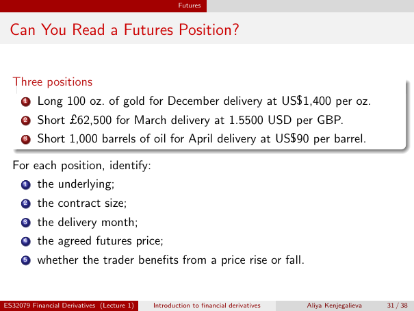

# Physical page 31 — raw extraction, needs review

<a id="page-31"></a>



Raw layout text below may flatten formulas, tables and glyphs. The image is source evidence; no semantic verification is claimed.

```text
                                                    Futures


 Can You Read a Futures Position?


  Three positions
      1   Long 100 oz. of gold for December delivery at US$1,400 per oz.
      2   Short £62,500 for March delivery at 1.5500 USD per GBP.
      3   Short 1,000 barrels of oil for April delivery at US$90 per barrel.

  For each position, identify:
      1   the underlying;
      2   the contract size;
      3   the delivery month;
      4   the agreed futures price;
      5   whether the trader benefits from a price rise or fall.


ES32079 Financial Derivatives (Lecture 1)   Introduction to financial derivatives   Aliya Kenjegalieva   31 / 38

```
