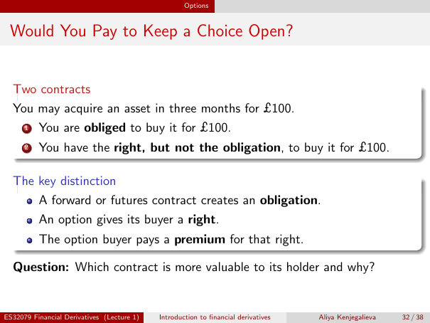

# Physical page 32 — raw extraction, needs review

<a id="page-32"></a>



Raw layout text below may flatten formulas, tables and glyphs. The image is source evidence; no semantic verification is claimed.

```text
                                                    Options


 Would You Pay to Keep a Choice Open?


  Two contracts
  You may acquire an asset in three months for £100.
      1   You are obliged to buy it for £100.
      2   You have the right, but not the obligation, to buy it for £100.

  The key distinction
      A forward or futures contract creates an obligation.
          An option gives its buyer a right.
          The option buyer pays a premium for that right.

  Question: Which contract is more valuable to its holder and why?


ES32079 Financial Derivatives (Lecture 1)   Introduction to financial derivatives   Aliya Kenjegalieva   32 / 38

```
