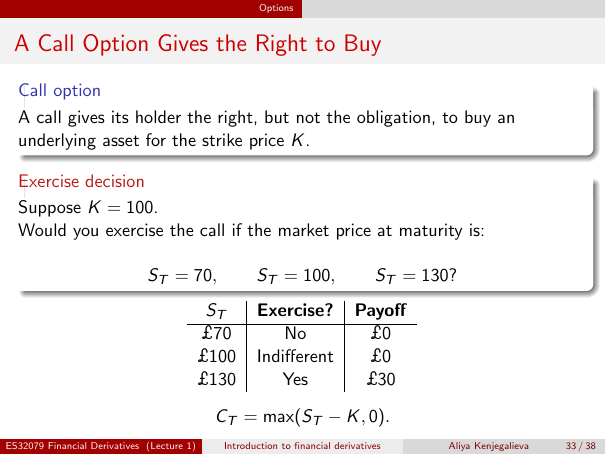

# Physical page 33 — raw extraction, needs review

<a id="page-33"></a>



Raw layout text below may flatten formulas, tables and glyphs. The image is source evidence; no semantic verification is claimed.

```text
                                                      Options


 A Call Option Gives the Right to Buy
  Call option
  A call gives its holder the right, but not the obligation, to buy an
  underlying asset for the strike price K .

  Exercise decision
  Suppose K = 100.
  Would you exercise the call if the market price at maturity is:

                              ST = 70,               ST = 100,                   ST = 130?
                                             ST      Exercise?              Payoff
                                            £70          No                  £0
                                            £100     Indifferent             £0
                                            £130        Yes                  £30

                                             CT = max(ST − K , 0).
ES32079 Financial Derivatives (Lecture 1)     Introduction to financial derivatives      Aliya Kenjegalieva   33 / 38

```
