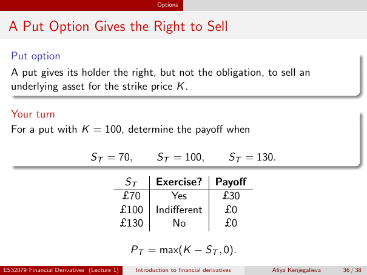

# Physical page 36 — raw extraction, needs review

<a id="page-36"></a>



Raw layout text below may flatten formulas, tables and glyphs. The image is source evidence; no semantic verification is claimed.

```text
                                                      Options


 A Put Option Gives the Right to Sell
  Put option
  A put gives its holder the right, but not the obligation, to sell an
  underlying asset for the strike price K .

  Your turn
  For a put with K = 100, determine the payoff when

                              ST = 70,                ST = 100,                   ST = 130.

                                             ST      Exercise?              Payoff
                                            £70         Yes                  £30
                                            £100     Indifferent             £0
                                            £130         No                  £0

                                             PT = max(K − ST , 0).
ES32079 Financial Derivatives (Lecture 1)     Introduction to financial derivatives       Aliya Kenjegalieva   36 / 38

```
