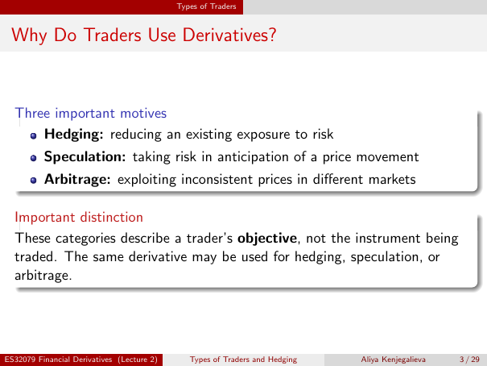

# Physical page 3 — raw extraction, needs review

<a id="page-3"></a>



Raw layout text below may flatten formulas, tables and glyphs. The image is source evidence; no semantic verification is claimed.

```text
                                            Types of Traders


 Why Do Traders Use Derivatives?


  Three important motives
      Hedging: reducing an existing exposure to risk
          Speculation: taking risk in anticipation of a price movement
          Arbitrage: exploiting inconsistent prices in different markets

  Important distinction
  These categories describe a trader’s objective, not the instrument being
  traded. The same derivative may be used for hedging, speculation, or
  arbitrage.


ES32079 Financial Derivatives (Lecture 2)      Types of Traders and Hedging   Aliya Kenjegalieva   3 / 29

```
