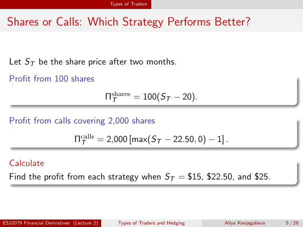

# Physical page 5 — raw extraction, needs review

<a id="page-5"></a>



Raw layout text below may flatten formulas, tables and glyphs. The image is source evidence; no semantic verification is claimed.

```text
                                             Types of Traders


 Shares or Calls: Which Strategy Performs Better?


  Let ST be the share price after two months.
  Profit from 100 shares
                                            Πshares
                                             T      = 100(ST − 20).

  Profit from calls covering 2,000 shares

                              Πcalls
                               T     = 2,000 [max(ST − 22.50, 0) − 1] .

  Calculate
  Find the profit from each strategy when ST = $15, $22.50, and $25.


ES32079 Financial Derivatives (Lecture 2)       Types of Traders and Hedging   Aliya Kenjegalieva   5 / 29

```
