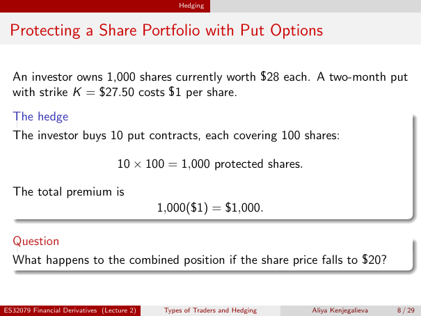

# Physical page 8 — raw extraction, needs review

<a id="page-8"></a>



Raw layout text below may flatten formulas, tables and glyphs. The image is source evidence; no semantic verification is claimed.

```text
                                                 Hedging


 Protecting a Share Portfolio with Put Options

  An investor owns 1,000 shares currently worth $28 each. A two-month put
  with strike K = $27.50 costs $1 per share.
  The hedge
  The investor buys 10 put contracts, each covering 100 shares:

                                   10 × 100 = 1,000 protected shares.

  The total premium is
                                            1,000($1) = $1,000.

  Question
  What happens to the combined position if the share price falls to $20?


ES32079 Financial Derivatives (Lecture 2)    Types of Traders and Hedging   Aliya Kenjegalieva   8 / 29

```
