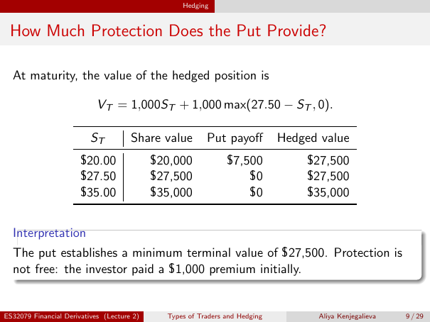

# Physical page 9 — raw extraction, needs review

<a id="page-9"></a>



Raw layout text below may flatten formulas, tables and glyphs. The image is source evidence; no semantic verification is claimed.

```text
                                                  Hedging


 How Much Protection Does the Put Provide?

  At maturity, the value of the hedged position is

                            VT = 1,000ST + 1,000 max(27.50 − ST , 0).

                          ST          Share value        Put payoff          Hedged value
                       $20.00               $20,000            $7,500            $27,500
                       $27.50               $27,500                $0            $27,500
                       $35.00               $35,000                $0            $35,000


  Interpretation
  The put establishes a minimum terminal value of $27,500. Protection is
  not free: the investor paid a $1,000 premium initially.


ES32079 Financial Derivatives (Lecture 2)     Types of Traders and Hedging         Aliya Kenjegalieva   9 / 29

```
