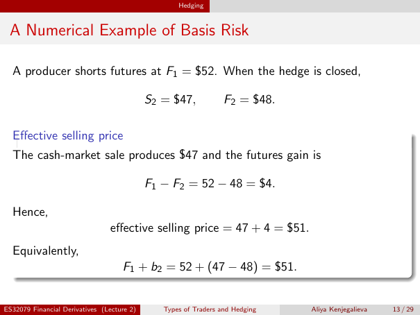

# Physical page 13 — raw extraction, needs review

<a id="page-13"></a>



Raw layout text below may flatten formulas, tables and glyphs. The image is source evidence; no semantic verification is claimed.

```text
                                                   Hedging


 A Numerical Example of Basis Risk

  A producer shorts futures at F1 = $52. When the hedge is closed,

                                            S2 = $47,            F2 = $48.

  Effective selling price
  The cash-market sale produces $47 and the futures gain is

                                            F1 − F2 = 52 − 48 = $4.

  Hence,
                                 effective selling price = 47 + 4 = $51.
  Equivalently,
                                    F1 + b2 = 52 + (47 − 48) = $51.


ES32079 Financial Derivatives (Lecture 2)      Types of Traders and Hedging   Aliya Kenjegalieva   13 / 29

```
