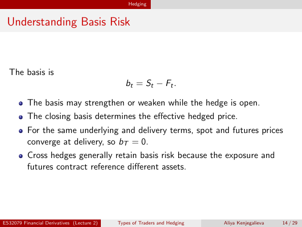

# Physical page 14 — raw extraction, needs review

<a id="page-14"></a>



Raw layout text below may flatten formulas, tables and glyphs. The image is source evidence; no semantic verification is claimed.

```text
                                                Hedging


 Understanding Basis Risk


  The basis is
                                               bt = St − Ft .

          The basis may strengthen or weaken while the hedge is open.
          The closing basis determines the effective hedged price.
          For the same underlying and delivery terms, spot and futures prices
          converge at delivery, so bT = 0.
          Cross hedges generally retain basis risk because the exposure and
          futures contract reference different assets.


ES32079 Financial Derivatives (Lecture 2)   Types of Traders and Hedging   Aliya Kenjegalieva   14 / 29

```
