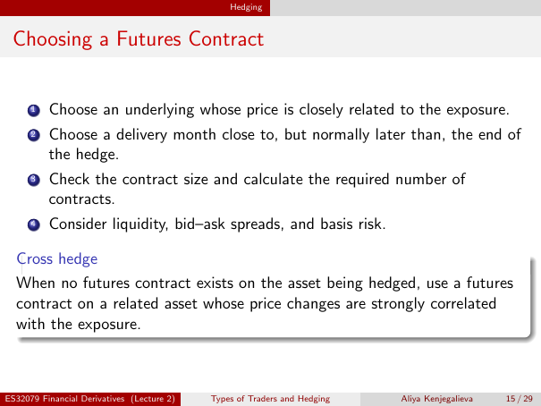

# Physical page 15 — raw extraction, needs review

<a id="page-15"></a>



Raw layout text below may flatten formulas, tables and glyphs. The image is source evidence; no semantic verification is claimed.

```text
                                                Hedging


 Choosing a Futures Contract


      1   Choose an underlying whose price is closely related to the exposure.
      2   Choose a delivery month close to, but normally later than, the end of
          the hedge.
      3   Check the contract size and calculate the required number of
          contracts.
      4   Consider liquidity, bid–ask spreads, and basis risk.

  Cross hedge
  When no futures contract exists on the asset being hedged, use a futures
  contract on a related asset whose price changes are strongly correlated
  with the exposure.


ES32079 Financial Derivatives (Lecture 2)   Types of Traders and Hedging   Aliya Kenjegalieva   15 / 29

```
