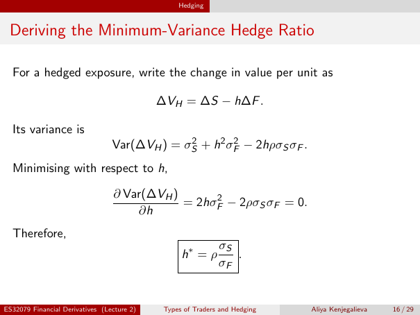

# Physical page 16 — raw extraction, needs review

<a id="page-16"></a>



Raw layout text below may flatten formulas, tables and glyphs. The image is source evidence; no semantic verification is claimed.

```text
                                                 Hedging


 Deriving the Minimum-Variance Hedge Ratio

  For a hedged exposure, write the change in value per unit as

                                            ∆VH = ∆S − h∆F .

  Its variance is
                                 Var(∆VH ) = σS2 + h2 σF2 − 2hρσS σF .
  Minimising with respect to h,

                                 ∂ Var(∆VH )
                                             = 2hσF2 − 2ρσS σF = 0.
                                     ∂h
  Therefore,
                                                             σS
                                                  h∗ = ρ        .
                                                             σF


ES32079 Financial Derivatives (Lecture 2)    Types of Traders and Hedging   Aliya Kenjegalieva   16 / 29

```
